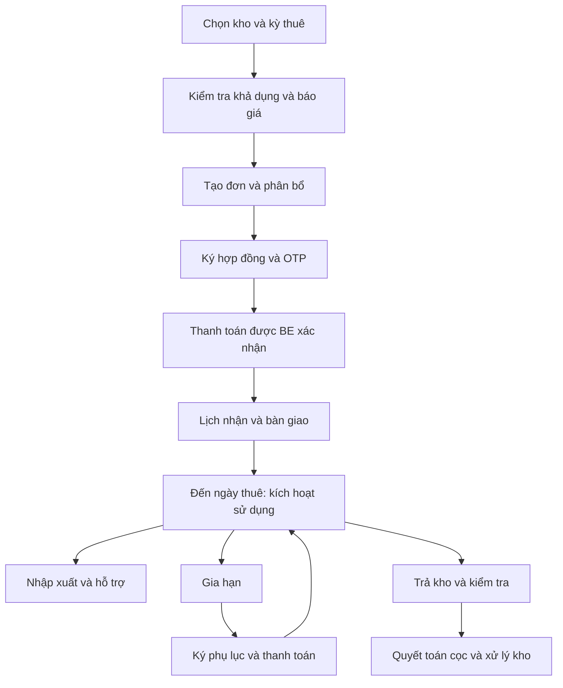

# Tổng hợp chức năng và cách hoạt động — WDP / NestBox Storage

Ngày đối chiếu: **02/11/2026**. Nguồn: mã nguồn tại nhánh `khang`, HEAD `15ac4db`, **bao gồm thay đổi local chưa commit** tại thời điểm rà soát.

Tài liệu mô tả bản code trong workspace, không khẳng định Render/Vercel hay database nhóm đã chạy đúng phiên bản này. Không đưa mật khẩu, token, connection string hoặc khóa VNPay vào tài liệu.

**Phạm vi role được nhóm xác nhận ngày 03/11/2026:** chỉ gồm `CUSTOMER`, `STAFF`, `MANAGER`, `ADMIN`. Business Operations Manager trong SRS khung cũ đã được bỏ khỏi phạm vi hiện tại; không tính việc thiếu role này là lỗi hoặc yêu cầu bổ sung. Việc bỏ role không tự chuyển các quyền/nghiệp vụ của role cũ cho Admin hay Manager; các chức năng còn lại được xét theo đặc tả đã điều chỉnh và phân quyền hiện có.

## 1. Dự án làm gì?

NestBox quản lý thuê kho tự quản tại **một cơ sở**. Khách chọn loại kho và kỳ thuê, nhận báo giá, đặt kho, ký hợp đồng, thanh toán, hẹn bàn giao, sử dụng kho, nhập/xuất hàng, gia hạn hoặc trả kho. Nhân viên xử lý vận hành; quản lý phân công, xử lý ngoại lệ và đối chiếu tài chính; quản trị viên quản lý tài khoản.

Ba ứng dụng dùng chung backend và dữ liệu:

| Thành phần | Công nghệ | Trách nhiệm |
|---|---|---|
| `FE/` | React 19, TypeScript, Vite, React Router, Tailwind, Lucide, React Three Fiber/Three.js | Website công khai và portal bốn role; xem kích thước/3D, đặt kho, ký, thanh toán, quản lý nghiệp vụ |
| `mobile/` | React Native 0.86, Expo SDK 57, Expo Router, SecureStore, SVG | Ứng dụng di động bốn role, chọn kho 2D, ký bằng cảm ứng, mở VNPay/PDF |
| `BE/` | NestJS 12, Prisma 7, PostgreSQL, `pg`, PDFKit, Nodemailer/Resend | Quy tắc nghiệp vụ, phân quyền, giao dịch dữ liệu, báo giá, hóa đơn, tài liệu, callback thanh toán |
| `BE/prisma/` | Schema và migrations | Mô hình dữ liệu, ràng buộc và lịch sử thay đổi cấu trúc |
| `scripts/`, `BE/test/`, các `*.spec.ts`, `FE/scripts/` | Script kiểm chứng và kiểm thử | Kiểm tra logic, luồng demo và giao diện theo phạm vi từng script |
| `swagger-docs-site/` | Thành phần tài liệu API | Hỗ trợ trình bày tài liệu API; API thật vẫn nằm ở BE |

Backend chạy với prefix `/api`; Swagger tại `/api/docs`; health tại `/api/health`. `main.ts` lắng nghe `0.0.0.0` và cấu hình CORS từ danh sách origin được phép.

**Cách đọc mức hoàn thành:** “có trong code” là có triển khai; “đã kiểm thử” chỉ áp dụng đúng phạm vi ghi ở mục kiểm chứng; “phụ thuộc cấu hình” nghĩa là cần dịch vụ/môi trường thật. Có màn hình hoặc có API chưa đủ để chứng minh luồng production đã thành công.

### Sơ đồ hành trình chính



## 2. Các đối tượng dữ liệu

| Đối tượng | Ý nghĩa |
|---|---|
| `User` | Tài khoản, vai trò và trạng thái truy cập |
| `Facility` | Cơ sở lưu trữ; không đồng nghĩa đã có quản lý nhiều chi nhánh |
| `StorageType` | Loại kho: kích thước, nhóm tủ/nhỏ/vừa/lớn, giá tháng, cho thuê ngày và số ngày tối thiểu |
| `StorageUnit` | Kho/tủ vật lý, mã kho, tầng/khu/hàng/vị trí và tình trạng |
| `UnitStaffAssignment` | Nhân viên phụ trách kho, người phân công và lịch sử |
| `ContactInquiry` | Yêu cầu tư vấn; không phải hợp đồng hay khoản giữ kho |
| `GuestBookingRequest` | Đặt kho của khách chưa đăng nhập, cần xác minh và nhận đơn |
| `Reservation` / `ReservationUnit` | Đơn thuê và các kho vật lý được phân bổ theo thời gian |
| `RentalContract` | Hợp đồng gắn phân bổ kho; chứa thông tin chấp thuận/snapshot chữ ký |
| `AdditionalService`, `AdditionalServiceInventory` | Vật tư mua hoặc thiết bị thuê, giá, đơn vị tính và tồn/công suất |
| `ReservationService`, `GuestBookingService` | Dịch vụ đã chọn và thông tin giá/phục vụ gắn hồ sơ |
| `Invoice`, `Payment` | Hóa đơn phải thu và khoản tiền thực tế đã ghi nhận; hai đối tượng khác nhau |
| `PaymentSubmission` | Khách thông báo đã chuyển khoản, chờ đối chiếu |
| `OnlinePaymentTransaction` | Phiên VNPay và trạng thái cổng thanh toán |
| `OnlinePaymentReconciliation` | Hồ sơ đối soát giao dịch bất thường/cần theo dõi hoàn tiền |
| `HandoverAppointment` | Lịch bàn giao, người xác nhận/thực hiện và biên bản |
| `RenewalRequest` | Gia hạn, báo giá, phụ lục, chữ ký và trạng thái kích hoạt |
| `StoredItem`, `StockMovement`, `StockMovementLine` | Hàng đang lưu; phiếu nhập/xuất và số lượng yêu cầu/thực nhận |
| `SupportRequest` | Hỗ trợ, sự cố, chuyển cấp, đề nghị trả sớm hoặc chuyển kho |
| `TransferRequest` | Lệnh chuyển từ kho cũ sang kho đích |
| `ReturnRequest`, `ReturnInspection` | Trả kho, kiểm tra tình trạng và bàn giao lại thực tế |
| `DepositSettlement`, `DepositSettlementIssue` | Tiền cọc, khoản khấu trừ và ghi nhận hoàn tiền |
| `MaintenanceRequest` | Bảo trì, phân công, kết quả sửa chữa và nghiệm thu |

Nguồn chuẩn: [schema.prisma](../BE/prisma/schema.prisma). Danh sách enum/trạng thái trích trực tiếp nằm ở phụ lục cuối tài liệu.

## 3. Phân quyền và trách nhiệm

| Nghiệp vụ | Customer | Staff | Manager | Admin |
|---|---|---|---|---|
| Tìm kho, xem báo giá | Xem/chọn | Tra cứu phục vụ vận hành | Tra cứu/quản lý danh mục được hỗ trợ | Không có quyền vận hành mặc định |
| Đặt kho | Tạo và xem đơn của mình | Xử lý hồ sơ vận hành còn cần can thiệp | Theo dõi theo màn hình/API được phép | Không duyệt thay Staff |
| Tư vấn | Gửi yêu cầu | Tiếp nhận/cập nhật | Theo dõi | Không xử lý |
| Ký hợp đồng/phụ lục | Ký tài liệu của mình | Đọc để vận hành | Đọc để đối chiếu | Không ký thay khách |
| VNPay | Thanh toán hóa đơn đủ điều kiện | Không xác nhận thu tiền | Theo dõi khoản thu/đối soát | Không thu tiền |
| Chuyển khoản | Gửi thông báo sau khi chuyển | Không xác minh khoản thu | Xác nhận/từ chối sau khi đối chiếu | Không xác minh thay Manager |
| Bàn giao | Gửi lịch, theo dõi | Xác nhận lịch và hoàn tất thực tế | Theo dõi | Không bàn giao |
| Nhập/xuất | Tạo yêu cầu và xem hàng | Kiểm đếm phần việc được giao | Phân công, theo dõi | Không kiểm đếm |
| Gia hạn | Gửi, ký phụ lục, thanh toán | Xử lý yêu cầu cần can thiệp | Theo dõi tài chính/ngoại lệ | Không gia hạn thay khách |
| Hỗ trợ/bảo trì | Báo vấn đề | Thực hiện việc được giao, chuyển cấp khi cần | Phân công, xử lý chuyển cấp, nghiệm thu | Không làm vận hành thường ngày |
| Chuyển kho | Gửi nhu cầu hỗ trợ | Lập/xử lý lệnh và xác nhận chuyển thực tế | Theo dõi/ra quyết định cần thiết | Không chuyển kho |
| Trả kho | Gửi yêu cầu | Kiểm tra và hoàn tất trả thực tế | Quyết định trả sớm, quyết toán cọc | Không kiểm tra kho |
| Tài khoản nội bộ | Không tạo | Không tạo | Không tự nâng quyền | Tạo Staff/Manager; bật/tắt tài khoản theo ràng buộc |

Điểm dễ nhầm: một số file/controller có tên `Manager...` vì lịch sử tái sử dụng code. **Tên file không quyết định quyền.** Phải xét `RolesGuard`, namespace URL, `StaffWorkflow`, `StaffLookup`, `ManagerAssignment` và kiểm tra trong service.

Hiện các nghiệp vụ `reservations`, `inquiries`, `appointments`, `renewals`, `returns`, `transfers`, `support-requests`, `maintenance`, `stock-movements` thuộc luồng Staff. FE/mobile chuyển một số URL cũ sang `/staff/management/...`. Manager giữ phân công, tài chính, ngoại lệ và quyền đọc tương ứng; Admin không phải tài khoản được thao tác tất cả.

Nguồn: [RolesGuard](../BE/src/modules/auth/roles.guard.ts), [metadata phân quyền](../BE/src/modules/auth/operation-access.ts), [FE operation-access](../FE/src/utils/operation-access.ts), [mobile operation-access](../mobile/src/utils/operation-access.ts).

## 4. Tài khoản, đăng nhập và phiên

- Khách đăng ký công khai luôn được tạo `CUSTOMER`; không nhận role đặc quyền từ form đăng ký.
- Mật khẩu được băm bằng `scrypt` có salt; so sánh an toàn, không trả password/hash ra giao diện.
- Đăng nhập trả bearer token ngẫu nhiên. Đây **không phải JWT** và không sử dụng Supabase Auth để đăng nhập ứng dụng.
- Phiên BE lưu trong bộ nhớ tiến trình, thời hạn **8 giờ**. Restart/deploy BE làm mất phiên; dữ liệu tài khoản vẫn còn trong PostgreSQL.
- BE kiểm tra tài khoản đang hoạt động khi sử dụng token. Đăng xuất xóa phiên; tài khoản bị vô hiệu hóa không tiếp tục dùng phiên cũ được.
- Admin tạo tài khoản nội bộ Staff/Manager; có ràng buộc tránh tự vô hiệu hóa hoặc làm mất khả năng quản trị theo service hiện có. Không có màn đăng ký Admin công khai.
- Mobile native lưu token bằng SecureStore; web/mobile-web có bộ lưu phía trình duyệt riêng. Phiên ở `localhost` không tự có trên domain Vercel khác.
- Có phản hồi lỗi đăng nhập, điều hướng theo role và chặn truy cập nhầm khu vực.

Nguồn: [auth.service.ts](../BE/src/modules/auth/auth.service.ts), [mobile auth](../mobile/src/auth), [FE router](../FE/src/app/router.tsx).

## 5. Danh mục, tìm kho và sơ đồ

### Website công khai

Có trang chủ, danh sách kho, chi tiết loại kho, hướng dẫn kích thước, nội dung tiện ích/cách thuê/cơ sở, mô hình 3D và luồng đặt kho. Giá/kích thước/khả dụng lấy từ catalog và API; tài sản hình ảnh/3D là phần trình bày, không thay dữ liệu kho thật.

### Mobile

- Tìm theo nhóm tủ, kho nhỏ/vừa/lớn; chọn loại, tầng và khu hiện có trong dữ liệu.
- Chọn ngày bắt đầu và một trong hai cách: **1/3/6/12 tháng** hoặc ngày kết thúc.
- Gọi `/booking/unit-map` theo đúng loại và kỳ thuê; không còn lấy tất cả loại rồi vẽ vào một nhóm.
- Kho thường hiển thị hai dãy và lối đi; tủ hiển thị các dãy ngang trong nhà, sảnh chung và cửa vào.
- Màu biểu thị trống/đang chọn/không khả dụng, trong ô giữ mã kho, trạng thái đầy đủ có trong accessibility label.
- Chọn kho → nút đặt → màn đặt kho giữ loại, mã kho, ngày và chế độ tháng/ngày. Không bắt chọn lại loại kho. Thay kế hoạch trả tiền không xóa lựa chọn kho.
- Có công cụ ước tính kích thước từ số đồ; kết quả là gợi ý, không bảo đảm đồ vừa thực tế.

**Giới hạn:** `StorageYard` sắp ô để chọn trên điện thoại; không phải bản vẽ khảo sát thực địa. `FloorPlanViewer` có chức năng sơ đồ theo vị trí cấu hình và thao tác xem; không được gọi bản vẽ chính xác nếu dữ liệu hàng/vị trí chưa đầy đủ.

## 6. Đặt kho và giữ kho

1. Khách chọn loại, số lượng, ngày/kỳ thuê, kế hoạch trả tiền và dịch vụ thêm.
2. BE kiểm tra toàn khoảng thuê, tình trạng kho và xung đột phân bổ; báo giá lấy từ PricingService.
3. Gửi đơn sẽ kiểm tra lại trong transaction. Việc chỉ xem báo giá hoặc chạm ô trên sơ đồ chưa giữ kho.
4. Đơn có nhánh **tự xác nhận** nếu đủ điều kiện: phân bổ kho vật lý, tạo hợp đồng và hóa đơn ban đầu. Không phải mọi đơn đều cần Manager bấm xác nhận.
5. Nếu không tự xác nhận được do điều kiện/xung đột cho phép xử lý tiếp, hồ sơ có thể còn `PENDING` để Staff xem xét. Không được trình bày mọi lần tạo đơn đều thành công/phân bổ ngay.
6. Xác nhận tạo một hợp đồng cho mỗi kho được phân bổ. Đơn nhiều kho phải kiểm tra đủ tài liệu cần ký.
7. BE dùng khóa và giao dịch mức Serializable ở các thao tác nhạy cảm, kèm kiểm tra idempotency để chống gửi trùng và tranh chấp kho.

**Thời gian hiện có trong source:** hạn giữ đơn tự động là **24 giờ** (`AUTOMATIC_RESERVATION_HOLD_MS`), còn một phiên VNPay là **5 phút**. Hai thời gian này khác nhau. Yêu cầu trước đây “5 phút tự hủy đơn” chưa tương đương với code hiện tại.

BE quét đơn hết hạn mỗi 60 giây và khi kiểm tra phù hợp. Nhánh hết hạn chỉ giải phóng hồ sơ thỏa điều kiện, không có khoản INITIAL đã thu và không còn phiên VNPay PENDING mới trong cửa sổ bảo vệ; cập nhật đơn EXPIRED, giải phóng phân bổ/vật tư được giữ, hủy hóa đơn/hợp đồng chưa thanh toán tương ứng. Không tự xóa lịch sử.

### Khách chưa đăng nhập

Có luồng guest booking: tạo yêu cầu → gửi liên kết xác minh email → xác minh token một lần → Customer có email phù hợp nhận đơn qua `claim`. Chỉ tạo yêu cầu guest chưa tạo hợp đồng/hóa đơn/giữ kho. Claim phải kiểm tra lại báo giá và khả dụng; mã booking đơn thuần không đủ để chiếm đơn.

Yêu cầu tư vấn (`inquiry`) là luồng khác: ghi nhận nhu cầu/liên hệ, xem chi tiết qua token riêng của khách; Staff tiếp nhận và cập nhật, không có nghĩa khách đã mua kho.

Nguồn: [booking.service.ts](../BE/src/modules/booking/booking.service.ts), [guest-booking](../BE/src/modules/guest-booking), [BookingWizardPage](../FE/src/pages/public/BookingWizardPage.tsx), [mobile booking](../mobile/src/app/customer/booking.tsx).

## 7. Giá thuê, cọc và dịch vụ thêm

### Giá thuê kho

Nguồn chuẩn là `StorageType.monthlyRate` và PricingService, không phải số fallback phía FE.

- Giá thiếu/null hoặc không hợp lệ không được tự coi bằng 0; một số loại tủ có **tiền cọc 0 theo quy tắc**, khác với giá bị thiếu.
- Tháng là tháng lịch; ngày kết thúc được xử lý theo khoảng sử dụng không tính ngày kết thúc ở phần tính thời gian.
- Thuê ngắn ngày chỉ cho loại có `allowDailyRental` và đạt `minRentalDays`; giá thuê ngày dựa trên giá tháng/30, làm tròn theo service.
- `PREPAID`: 3 tháng giảm 5%, 6 tháng 10%, 12 tháng 15%; không tự giảm ở các kỳ khác.
- `PAY_MONTHLY`: không giảm trả trước.
- Tiền cọc không được áp chiết khấu. Tủ không cọc; kho nhỏ thuê ngày dùng cọc theo tiền thuê ở quy tắc hiện tại; các trường hợp còn lại dùng giá tháng × số kho.
- Tổng giá trị hợp đồng gồm tiền thuê sau giảm, cọc và dịch vụ. **Số phải trả ban đầu không luôn bằng tổng hợp đồng**: PAY_MONTHLY thu chu kỳ đầu + cọc + phần dịch vụ phải thu kỳ đầu.
- Phí/thuế không có chính sách dữ liệu được trả là chưa có; không dựng thêm khoản 0 hoặc số giả.

### Dịch vụ thêm

- `PURCHASE` + `ONE_TIME`: giá × số lượng, thu một lần.
- `RENTAL` + `DAY`: giá × số lượng × số ngày thiết bị.
- `RENTAL` + `MONTH`: giá × số lượng × số tháng lịch; khoảng thuê thiết bị phải nằm trong kỳ thuê kho.
- Có kiểm tra tồn kho/công suất trước và trong luồng đặt; không đồng nghĩa chọn thiết bị là dịch vụ nhân công không giới hạn lượt.
- Dịch vụ và giá được chốt snapshot theo hồ sơ. Đổi giá danh mục không phải thao tác viết lại báo giá/hóa đơn lịch sử.
- PAY_MONTHLY có logic phân bổ dịch vụ thuê theo kỳ hóa đơn. Vật tư mua không bị thu lặp hàng tháng.
- Có danh mục, ảnh/mô tả, bật/tắt, giá và tồn/công suất theo API hỗ trợ; nguồn dữ liệu thật quyết định dịch vụ nào có thể chọn.

API chính: `GET /api/storage`, `GET /api/storage/:id`, `GET /api/booking/catalog`, `POST /api/pricing/quote`, `POST /api/booking/availability`, `POST /api/booking/unit-map` và `/api/additional-services/...`.

Nguồn: [PricingService](../BE/src/modules/pricing/pricing.service.ts), [additional-services](../BE/src/modules/additional-services), [PriceBreakdown mobile](../mobile/src/components/price-breakdown.tsx).

## 8. Hợp đồng, chữ ký, OTP và PDF

1. Hệ thống tạo tài liệu từ phân bổ/báo giá đã chốt.
2. Khách mở hợp đồng, xem nội dung/PDF và tích đồng ý.
3. Nhập tên xác nhận, vẽ chữ ký bằng chuột hoặc cảm ứng; có xóa/ký lại.
4. Gửi mã OTP đến email tài khoản, nhập mã rồi xác nhận.
5. BE kiểm tra quyền sở hữu, hash snapshot, chữ ký và challenge; lưu bằng chứng xác nhận/thời điểm/nội dung tương ứng.
6. Khóa thanh toán yêu cầu tài liệu cần thiết đã ký. Không cho đổi query frontend để bỏ qua bước này.

OTP hiện có thời hạn 10 phút, tối đa 5 lần thử; gửi lại sau 60 giây và giới hạn lượt gửi theo tài khoản. Challenge chờ nằm trong bộ nhớ một tiến trình; restart làm mất mã đang chờ. Bằng chứng đã chấp thuận được lưu vào hồ sơ. Cần SMTP/Resend hoạt động; thiếu email không có OTP mặc định để bỏ qua.

Có PDF hợp đồng, phụ lục, hóa đơn và biên bản chuyển kho đã hoàn tất, phân quyền theo hồ sơ. PDF hóa đơn có thể sao chiếu bằng chứng ký từ tài liệu liên quan; không phải ký thêm hóa đơn. Mobile tải bằng token rồi mở/chia sẻ file qua thiết bị.

Thông tin bên cho thuê/điều khoản lấy từ cấu hình. Thiếu thông tin hoặc chưa phê duyệt thì tài liệu ghi **DỰ THẢO**; đổi cấu hình sau đó không tự nâng bản đã ký trước thành bản chính thức.

Đây là chữ ký vẽ và xác nhận điện tử trong ứng dụng, không nên gọi là chữ ký số được chứng thực. PDF nội bộ không thay thế hóa đơn điện tử thuế.

Nguồn: [contracts](../BE/src/modules/contracts), [signing](../BE/src/modules/signing), [documents](../BE/src/modules/documents), [document-acceptance mobile](../mobile/src/components/document-acceptance.tsx).

## 9. Thanh toán và VNPay

### Hóa đơn/khoản thu

Có hóa đơn ban đầu, định kỳ và gia hạn cùng nhánh quyết toán theo mô hình dữ liệu. Ghi nhận khoản thu kiểm tra số dư, trạng thái và điều kiện ký; không được thu vượt hoặc thu vào hóa đơn đã hủy. Một hóa đơn có thể có nhiều khoản thu hợp lệ. Xem dư nợ, lịch sử thu và các khoản cần đối chiếu là chức năng khác với tạo hóa đơn.

Định kỳ có API/nghiệp vụ sinh và đồng bộ kỳ thu; không mặc định rằng có cron riêng gửi mọi hóa đơn hằng tháng nếu chưa triển khai lịch chạy. Xem `BillingService`, controller và script `billing:backfill-recurring` trước khi thiết kế vận hành tự động production.

### Chuyển khoản ngân hàng

Khách xem ngân hàng/số tài khoản/nội dung; ứng dụng tạo VietQR khi cấu hình hợp lệ. Sau chuyển tiền thực tế, khách gửi thông báo → Manager đối chiếu và xác nhận/từ chối → khoản thu mới cập nhật hóa đơn. QR và nút “Tôi đã chuyển khoản” không phải bằng chứng đã thu tiền. Cấu hình thiếu thì UI báo chưa khả dụng.

Còn có endpoint thông báo thanh toán **demo** trong BE. Chỉ bật khi `DEMO_PAYMENT_ENABLED=true`, không phải production và tài khoản thuộc nhóm demo mà service cho phép; Manager demo vẫn phải xác nhận. Khoản này được đánh dấu không có tiền thật. Sự tồn tại endpoint không chứng minh mọi giao diện đang hiển thị nút demo hoặc được phép dùng để thay kết quả VNPay.

### VNPay

1. Customer tạo phiên từ hóa đơn đủ điều kiện; amount do BE lấy từ số dư, không cho frontend tự chọn.
2. BE ký URL VNPay, khóa chống tạo trùng, tái sử dụng phiên PENDING còn hiệu lực.
3. Khách nhập thông tin trên Sandbox/cổng VNPay.
4. VNPay gửi **IPN server-to-server** vào BE. BE kiểm chữ ký HMAC SHA-512, mã đơn, số tiền và trạng thái.
5. Callback hợp lệ thành công → logic khoản thu hiện có → hóa đơn và trạng thái liên quan cập nhật trong transaction. IPN lặp không được tạo khoản thu lặp.
6. Web quay về `/customer/payments/vnpay-return`; trang này hỏi BE và hiển thị kết quả, không tự đánh dấu PAID từ query string.
7. Mobile mở VNPay bằng trình duyệt, lưu phiên, có “Mở lại VNPay”, poll trạng thái và kiểm tra lại khi app về foreground. Hiện chưa có luồng tự trở lại màn native bằng payment deep link hoàn chỉnh; khách quay về app để xem cập nhật.

Phiên VNPay local hiện **5 phút**. Hết phiên vẫn có thể thử phiên mới nếu hóa đơn/đơn còn đủ điều kiện. IPN thành công trễ sau hết phiên local vẫn được xử lý theo trạng thái đơn; không bỏ qua tiền chỉ vì bộ đếm frontend đã hết.

Nếu đơn đã hết hạn/hóa đơn VOID mà VNPay báo thành công hợp lệ: tạo hồ sơ đối soát, **không tự kích hoạt lại kho**. Manager có luồng ghi nhận cần hoàn tiền và hoàn tất đối soát sau khi có căn cứ; đây không phải API tự chuyển tiền hoàn qua ngân hàng.

**Khoảng trống còn lại:** chưa thấy triển khai QueryDR trong `VnpayService` hoặc endpoint hòa giải chủ động từ VNPay. Nếu IPN không tới/không được chấp nhận thì status endpoint chỉ đọc dữ liệu local và có thể vẫn PENDING/EXPIRED; thêm log không thay thế truy vấn xác minh với nhà cung cấp. Không được mô tả QueryDR đã hoàn thành.

Phải tách hai URL:

- Return URL: domain **FE đang dùng** + `/customer/payments/vnpay-return`.
- IPN URL: domain **BE công khai** + `/api/payments/vnpay/ipn`, đăng ký ở phía merchant VNPay. Không trỏ IPN sang Vercel FE chỉ vì vừa đổi domain web.

Không có bằng chứng trong lần rà này rằng giao dịch Sandbox cụ thể trước đây đã được đối soát thành công trên Render. Không sửa DB tiền production từ return params hoặc thao tác tay để “qua demo”.

Nguồn: [OnlinePaymentService](../BE/src/modules/billing/online-payment.service.ts), [VnpayService](../BE/src/modules/billing/vnpay.service.ts), [CustomerVnpayReturnPage](../FE/src/pages/customer/CustomerVnpayReturnPage.tsx), [OnlinePayment mobile](../mobile/src/portals/online-payment.tsx).

## 10. Lịch bàn giao và tự bắt đầu sử dụng

- Khách có hồ sơ đủ điều kiện ký/thanh toán gửi yêu cầu lịch.
- Cho nhận chìa/xem kho/hướng dẫn từ **3 ngày trước ngày bắt đầu thuê**, và phải trước ngày kết thúc; không hoàn tất trước giờ hẹn.
- Lịch mới đủ điều kiện hiện được tạo thẳng `CONFIRMED` trong `createCustomerAppointment`, không bắt Staff duyệt mọi lịch. Có thao tác xác nhận vận hành cho trường hợp trạng thái tương ứng; Staff ghi biên bản và hoàn tất thực tế.
- Nếu hoàn tất sớm, hợp đồng còn chờ tới ngày thuê; ứng dụng phân biệt `WAITING_FOR_RENTAL_START` với `ACTIVE`.
- BE quét mỗi **30 giây**, khi đến ngày thuê và vẫn đủ điều kiện thì kích hoạt hợp đồng/kho. Có kiểm tra lại thanh toán, thời gian và hồ sơ trong transaction.
- Hết kỳ không có nghĩa đồ đã ra khỏi kho: không tự giải phóng kho OCCUPIED chỉ vì quá ngày thuê.

Việc chặn khách mở cửa/đưa hàng vào sớm ở ngoài đời cần cơ chế vận hành hoặc khóa ra vào thực tế. Đổi trạng thái phần mềm không chứng minh đã tích hợp khóa thông minh.

Nguồn: [AppointmentsService](../BE/src/modules/appointments/appointments.service.ts), [handover-report](../BE/src/modules/appointments/handover-report.ts).

## 11. Kho đang thuê, nhập và xuất hàng

- Khách xem kho/hợp đồng đang sử dụng, ngày hết hạn, dư nợ và các yêu cầu liên quan.
- Có trạng thái quá hạn tính từ kỳ thuê; không tự coi trả kho hoặc tự xóa hàng.
- Customer tạo phiếu `INBOUND`/`OUTBOUND` theo hợp đồng và mặt hàng, số lượng, lịch/ghi chú.
- Manager phân công Staff đang hoạt động; Staff nhận phần việc được giao và ghi số lượng thực tế sau kiểm đếm.
- Hoàn tất cập nhật tồn hàng trong transaction; xuất kiểm tra không vượt tồn, chống ghi nhận lặp, có kiểm tra điều kiện quyền sử dụng kho.
- Khách xem hàng đang lưu và lịch sử phiếu; số yêu cầu và số thực tế được phân biệt.

Đây là quản lý tồn theo mặt hàng/đơn vị và số lượng. Chưa nên gọi là WMS công nghiệp đầy đủ với barcode, định vị từng kiện, thiết bị IoT hay kiểm kê tự động nếu không có tích hợp tương ứng.

Nguồn: [stock-movements](../BE/src/modules/stock-movements), [StockMovementsPage web](../FE/src/pages/stock/StockMovementsPage.tsx), các route `stock-movements`/`stored-items` mobile.

## 12. Gia hạn và phụ lục

Customer gửi số tháng và kế hoạch trả tiền. BE kiểm tra hợp đồng đang hoạt động, hạn cũ, tình trạng công nợ/điều kiện và khả dụng kho trong khoảng gia hạn. Có nhánh tự duyệt đủ điều kiện; yêu cầu chưa đủ có thể để Staff xử lý theo quyền hiện có.

Khi duyệt, tạo báo giá/hóa đơn và phụ lục với nội dung thay đổi, mã/hash tài liệu; Customer xem và ký phụ lục bằng chữ ký vẽ + OTP. Thanh toán đủ hóa đơn kích hoạt cần thiết mới hoàn tất gia hạn, cập nhật hạn hợp đồng/phân bổ; gửi yêu cầu hoặc duyệt thôi chưa phải đã dùng thêm thời gian.

Lịch sử hợp đồng hiển thị các lần gia hạn, hạn cũ/mới, thời điểm và chứng từ. Phụ lục không ghi đè bằng chứng hợp đồng gốc hoặc phụ lục đã ký trước. Luồng hiện tập trung gia hạn tháng; không tự suy ra hỗ trợ mọi kỳ ngày tùy ý.

Nguồn: [RenewalsService](../BE/src/modules/renewals/renewals.service.ts), [ContractRenewalHistory mobile](../mobile/src/components/contract-renewal-history.tsx).

## 13. Hỗ trợ, sự cố, bảo trì và chuyển kho

### Hỗ trợ

Customer tạo yêu cầu theo đơn/hợp đồng/kho/hóa đơn, chọn nhóm vấn đề và mô tả. Manager phân công/đổi người, ưu tiên. Staff được giao bắt đầu xử lý, ghi kết quả hoặc chuyển cấp. Manager giải quyết hồ sơ `ESCALATED`; quyết định đề nghị chuyển kho không tự thực hiện chuyển kho.

### Bảo trì

Staff báo tình trạng cần bảo trì; kho đang có khách phải xét ảnh hưởng tới người thuê và chuyển kho nếu cần. Manager phân công, Staff bắt đầu/sửa chữa/gửi kết quả, Manager nghiệm thu hoặc yêu cầu làm lại. Tình trạng kho và xung đột phân bổ được kiểm tra trước khi đưa kho về khả dụng. Có nhánh liên kết sự cố, chuyển kho và bảo trì.

### Chuyển kho

Customer gửi nhu cầu qua hỗ trợ; Staff xử lý lệnh chuyển. Kho đích được kiểm tra theo **cùng loại kho** và phần kỳ thuê còn lại, không chỉ nhìn trạng thái hôm nay. Duyệt/giữ kho và hoàn tất chuyển là các bước khác nhau.

Sau chuyển thực tế: cập nhật kho trên hợp đồng, giữ lịch sử nguồn/đích, người làm/thời điểm; liên kết hỗ trợ và tạo/giữ quy trình bảo trì kho cũ theo điều kiện. Có PDF biên bản chuyển trong hồ sơ hợp đồng. Chuyển cùng loại không tự đổi giá/cọc/thời hạn hoặc sửa chữ ký gốc.

Nguồn: [support](../BE/src/modules/support), [maintenance](../BE/src/modules/maintenance), [transfers](../BE/src/modules/transfers), [UnitStaff](../BE/src/modules/unit-staff).

## 14. Trả kho, trả sớm và tiền cọc

1. Khách gửi yêu cầu trả kho khi đủ điều kiện; đề nghị trả trước hạn cần nhánh hỗ trợ và quyết định Manager, không tự coi là trả bình thường.
2. Staff tiếp nhận, bắt đầu kiểm tra, ghi từng hạng mục/vi phạm và kết quả theo kho, kiểm tra hàng còn lưu.
3. Ghi nhận trả kho thực tế và kết thúc hồ sơ theo điều kiện. Chưa bàn giao lại ngoài đời thì không giải phóng cho khách khác chỉ vì khách bấm yêu cầu.
4. Hệ thống lập dữ liệu quyết toán từ cọc và nghĩa vụ liên quan; Manager xét khoản khấu trừ, lý do và số hoàn.
5. Ghi nhận đã hoàn khi tiền thực sự hoàn, có tham chiếu; không mặc định hệ thống đã tích hợp API hoàn tiền ngân hàng.
6. Kho có vấn đề đi qua bảo trì; kho đạt điều kiện mới trở lại sẵn sàng. Hồ sơ cũ tiếp tục tra cứu được.

Nguồn: [returns](../BE/src/modules/returns), [deposit-settlements](../BE/src/modules/deposit-settlements).

## 15. Trang và công việc của từng role

### Customer

Trang chủ/tổng quan; tìm kho và kích thước; đặt kho; đơn và lịch sử đặt; kho đang thuê; hợp đồng/chữ ký/PDF/lịch sử gia hạn-chuyển; hóa đơn/VNPay/chuyển khoản/lịch sử thu; lịch bàn giao; nhập-xuất/hàng đang lưu; gia hạn; trả kho/tiền cọc; chuyển kho qua hỗ trợ; hỗ trợ; thông báo và hồ sơ/tài khoản.

### Staff

Bàn làm việc và việc ưu tiên; kho phụ trách; tư vấn; đơn cần xử lý; lịch và biên bản bàn giao; kho/hợp đồng để tra cứu; nhập-xuất được giao; hỗ trợ; bảo trì; gia hạn cần xử lý; chuyển kho; kiểm tra trả kho; lịch sử công việc; thông báo và tài khoản. Không thu tiền/hoàn cọc thay Manager.

### Manager

Tổng quan tình trạng kho/công nợ; phân công nhân viên cho công việc và phụ trách kho; phê duyệt ngoại lệ/hỗ trợ chuyển cấp/nghiệm thu/trả sớm; hóa đơn, khoản thu, xác nhận chuyển khoản, đối soát VNPay, quyết toán cọc; tra cứu hợp đồng/kỳ thuê/khách; kho vật lý, loại kho và dịch vụ theo quyền API; báo cáo và thông báo.

### Admin

Tổng quan tài khoản, danh sách/tra cứu người dùng, tạo Staff/Manager và thay trạng thái truy cập theo điều kiện. Các trang role/settings/assignments/activity/facility cũ có nhánh redirect, không phải toàn bộ chức năng quản trị mới. **Chưa có màn/API cấu hình thông số hệ thống tổng quát** chỉ vì route `settings` tồn tại; cấu hình hiện chủ yếu qua môi trường/code. Mobile đang có shortcut Cài đặt trỏ tới trang redirect, cần bỏ hoặc triển khai thật nếu muốn dùng.

## 16. Web và mobile giống/khác nhau

| Nội dung | Web | Mobile |
|---|---|---|
| Backend, dữ liệu, role, giá, ký, tiền | Dùng BE chung | Dùng BE chung |
| Tìm kho | Catalog, hướng dẫn kích thước, mô hình 3D/booking web | Sơ đồ chọn ô 2D theo loại/khu, tủ trong nhà, kích thước gợi ý |
| Điều hướng | Menu/nhóm trong portal, route React Router | Expo Router; thanh dưới, nhóm mở/đóng, icon và nhãn ngắn |
| Ký | Vẽ bằng chuột/cảm ứng + OTP | Vẽ cảm ứng + OTP; dùng native view-shot cho ảnh ký |
| PDF | Trình xem/tải/in trong browser | Tải file, mở/chia sẻ bằng ứng dụng thiết bị |
| VNPay | Return page trên domain web + kiểm tra BE | Mở browser ngoài, lưu phiên và kiểm tra khi quay lại app |
| Thông báo | Kiểm tra định kỳ khi app mở | Kiểm tra định kỳ/foreground; không phải push nền đã triển khai |
| Phiên | Bộ lưu trình duyệt + phiên BE | SecureStore native + cùng phiên BE |

Không khẳng định mobile giống web 100% về trải nghiệm hoặc mọi màn tùy biến. Có nhiều màn mobile dùng component generic theo resource; có route redirect và giới hạn đã liệt kê.

### Đợt UI mobile gần nhất

Menu dùng icon theo chức năng, bỏ số lượng mục cạnh tên nhóm; mỗi lần mở một nhóm, tìm kiếm tên có/không dấu. Giữ số tiền, tồn kho và số hồ sơ cần xử lý. Tiêu đề/hướng dẫn được rút gọn/thu vào nút thông tin; nút, search, mật khẩu, checkbox và bước đặt dùng icon; Staff/Customer/Manager/Admin có điều hướng theo role; dịch vụ thêm chia Thuê/Mua, mở khi cần; bộ lọc trạng thái thu gọn. Bản sửa nằm trong working tree, chưa tự deploy.

## 17. Tự động hóa và phần cần người thao tác

| Công việc | Cách hiện có |
|---|---|
| Báo giá/khả dụng | BE tính lại từ dữ liệu và thời gian, không tự xác nhận chỉ từ frontend |
| Xác nhận đặt kho | Có nhánh tự xác nhận; hồ sơ ngoại lệ có thể cần Staff |
| Đơn hết hạn | Quét 60 giây và kiểm tra liên quan; chỉ áp dụng điều kiện service |
| Phiên VNPay hết hạn | Theo TTL 5 phút khi xử lý/đọc trạng thái và tạo phiên |
| Thu VNPay | Tự ghi nhận khi IPN hợp lệ; thiếu IPN chưa có QueryDR tự khôi phục |
| Chuyển khoản tay | Manager đối chiếu tiền thực nhận |
| Đến ngày thuê sau nhận chìa sớm | Quét 30 giây, kiểm lại và kích hoạt hợp đồng |
| Lịch bàn giao mới đủ điều kiện | Tự tạo CONFIRMED; nhân viên vẫn phải bàn giao thực tế |
| Gia hạn | Có tự duyệt khi đủ điều kiện; ký và trả tiền vẫn bắt buộc |
| Thông báo/làm mới UI | Poll dữ liệu, tránh ghi đè form đang nhập; đọc thông báo không hoàn thành nghiệp vụ |
| Phân công, kiểm đếm, bàn giao thực tế | Người có quyền thao tác và xác nhận |
| Nghiệm thu/hoàn tiền/khấu trừ | Manager quyết định/ghi nhận dựa chứng từ; không có robot kiểm tra ngoài đời |

## 18. Cách chạy local và cấu hình cần thiết

### Chuẩn bị

Cài Node phù hợp toolchain hiện tại, cài dependencies trong từng thư mục bằng lockfile (`npm ci` nếu lockfile đồng bộ), tạo `.env` từ mẫu. Nếu native dependency thay đổi, development build Android/iOS có thể cần dựng lại; reload JS không bổ sung native module bị thiếu.

| Nơi | Biến/nhóm cấu hình | Dùng cho |
|---|---|---|
| BE | `DATABASE_URL`, `DIRECT_URL` | Runtime PostgreSQL và Prisma config; không chép connection string vào docs |
| BE | `PORT`, `FRONTEND_URL`, origin trong `cors-origins.ts` | HTTP và CORS |
| FE | `VITE_API_URL` | Base URL API đang chạy |
| Mobile | `EXPO_PUBLIC_API_URL` | Base URL API, gồm `/api`; biến public không đặt bí mật |
| BE email | `EMAIL_PROVIDER`, nhóm `SMTP_*` hoặc `RESEND_API_KEY`, `EMAIL_FROM_ADDRESS`, `EMAIL_FROM_NAME` | Guest verification và OTP |
| BE tài liệu | `CONTRACT_LEGAL_NAME`, `CONTRACT_TAX_CODE`, `CONTRACT_ADDRESS`, `CONTRACT_REPRESENTATIVE`, `CONTRACT_TERMS_APPROVED`, `CONTRACT_TERMS_VERSION` | Phát hành hợp đồng/phụ lục |
| BE ngân hàng | `WDP_BANK_NAME`, `WDP_BANK_CODE`, `WDP_BANK_ACCOUNT_NUMBER`, `WDP_BANK_ACCOUNT_NAME` | Thông tin chuyển khoản/VietQR |
| BE VNPay | `VNPAY_TMN_CODE`, `VNPAY_HASH_SECRET`, `VNPAY_PAYMENT_URL`, `VNPAY_RETURN_URL` | Ký URL/xác minh callback; IPN còn phải đăng ký với VNPay |

Lệnh thường dùng, chạy tại đúng thư mục:

```powershell
# BE: sinh client nếu cần (không phải chạy migration)
cd BE
npm run prisma:generate
npm run start:dev

# FE: terminal khác, tại FE
npm run dev

# Mobile: terminal khác, tại mobile
npm start
```

Mặc định BE `http://127.0.0.1:3000/api`, web Vite thường `http://localhost:5173`. Android Emulator dùng địa chỉ máy host `http://10.0.2.2:3000/api` nếu BE ở Windows; máy thật dùng LAN IP hoặc HTTPS BE công khai. `localhost` trên điện thoại là chính điện thoại. Base URL sai/thiếu `/api` có thể trả 404; CORS web và khả năng truy cập mạng mobile là hai kiểm tra khác nhau.

Production BE phải build/start đúng commit và cấu hình. Sửa `.env`/source local không thay bản đang chạy Render; FE/mobile đã build cũng cần bản mới nếu cấu hình public thay đổi. Không tự chạy seed/reset/migrate trên DB nhóm chỉ để thử tài liệu; script seed có thể tạo/sửa dữ liệu.

## 19. Kịch bản demo đầy đủ

1. Customer đăng nhập → tìm loại, kỳ thuê, chọn kho → dịch vụ nếu cần → báo giá → gửi đơn.
2. Kiểm tra tự xác nhận và phân bổ; nếu còn PENDING thì vào Staff xử lý đúng hồ sơ.
3. Customer mở đủ hợp đồng → đọc PDF → đồng ý/vẽ ký → nhận/nhập OTP.
4. Thanh toán: VNPay Sandbox có IPN hợp lệ; hoặc chuyển khoản và Manager xác minh sau đối chiếu. Kiểm tra Payment và số dư hóa đơn, không chỉ trang “thành công” của cổng.
5. Customer gửi lịch nhận → kiểm tra lịch tự CONFIRMED (hoặc Staff xử lý lịch còn cần xác nhận) → Staff ghi biên bản và hoàn tất đúng thời gian.
6. Nếu nhận chìa trước ngày thuê: màn còn chờ bắt đầu, tới ngày BE mới kích hoạt. Sau ACTIVE mới thử nhập/xuất theo điều kiện.
7. Customer yêu cầu nhập → Manager giao Staff → Staff kiểm đếm/hoàn tất → xem tồn. Thử xuất và kiểm tra không vượt tồn.
8. Gia hạn → kiểm tra duyệt/báo giá/phụ lục → ký OTP → thanh toán → hạn mới và lịch sử.
9. Báo sự cố → phân công → Staff xử lý/chuyển cấp → Manager quyết định; nếu cần chuyển, hoàn tất lệnh chuyển thực tế và xem biên bản.
10. Trả kho/đề nghị trả sớm → kiểm tra/hàng tồn → trả thực tế → Manager quyết toán và ghi nhận hoàn tiền → theo dõi bảo trì/kho sẵn sàng.
11. Admin thử tài khoản nội bộ và vô hiệu hóa tài khoản thử; kiểm tra role không làm được việc ngoài quyền.

Không dùng kịch bản này như quyền tự chuyển tiền hoặc sửa tài khoản/dữ liệu thật. Dùng môi trường thử và dữ liệu được nhóm cho phép.

## 20. Điểm còn thiếu và cần kiểm chứng trước khi nói “xong”

1. **VNPay:** QueryDR chưa triển khai; cần xác minh merchant-side IPN và đúng bản BE deploy. Thiếu callback vẫn có thể mắc chờ; có log IPN không chứng minh đã đồng bộ tiền.
2. **Thời gian:** giữ đơn 24 giờ, phiên VNPay 5 phút. Nhóm cần thống nhất chính sách; tài liệu không coi hai giá trị bằng nhau.
3. **Phiên/OTP:** lưu bộ nhớ một tiến trình, không bền qua restart và chưa phù hợp nhiều replica nếu không có kho dùng chung.
4. **Admin settings:** đang redirect, chưa có cấu hình nghiệp vụ tổng quát qua UI; shortcut mobile Cài đặt chưa phải chức năng thật.
5. **Sơ đồ:** bố trí lựa chọn mobile là minh họa; cần dữ liệu/bản vẽ thật nếu muốn sơ đồ cơ sở đúng thực địa.
6. **Bàn giao sớm:** chỉ kiểm soát quyền/trạng thái phần mềm; cần quy trình nhận chìa/kiểm soát cửa ngoài đời.
7. **Hoàn tiền:** ghi nhận đối soát/hoàn tiền không đồng nghĩa tích hợp cổng chuyển hoàn tự động.
8. **Thông báo:** poll khi app chạy, chưa thấy push nền/email cho mọi thay đổi nghiệp vụ.
9. **Kiểm thử UI:** menu Customer đã xem trên emulator ở lượt UI gần nhất; chưa kiểm thử mọi màn của bốn role trên Android và iOS. Web/mobile chưa được chứng minh ngang nhau tuyệt đối.
10. **Database thật:** lần này không truy vấn/seed/sửa DB nhóm, không xác minh đủ giá thực tế cho mọi StorageType. Giá seed/schema không chứng minh giá production hợp lệ.
11. **Đặc tả:** không thấy thư mục `docs`/file đặc tả mới trong checkout này trước khi tạo tài liệu. Có các audit `.md` cũ trong FE/mobile; chưa thể kết luận đạt toàn bộ đặc tả đã từng được gửi ở máy/nhánh khác.
12. **Tài liệu cũ:** phần đầu README vẫn ghi “chưa có thanh toán/hợp đồng…” của milestone cũ, đã lỗi thời so với source. Ưu tiên source và tài liệu tổng hợp này cho trạng thái lần rà này.

## 21. Kết quả kiểm chứng của lần tổng hợp này

Các test unit/mock không chứng minh dịch vụ email, VNPay Sandbox, thiết bị thật hoặc triển khai production đã hoạt động.

| Kiểm tra | Kết quả | Giới hạn |
|---|---|---|
| BE `npm run test:unit` | **24 file, 130 test đạt** | Bộ unit được chọn trong package.json; không chạy lại toàn bộ integration/E2E với DB |
| FE `npm run build` | **Đạt** | Có cảnh báo chunk JS lớn hơn 500 kB; build không chứng minh mọi API production chạy đúng |
| Mobile `npm run typecheck` | **Đạt** | Kiểm tra TypeScript |
| Mobile `npm run lint` | **Đạt, không lỗi/cảnh báo sau dọn import** | Lần chạy trước phát hiện hai import không dùng ở payment-center; đã sửa và chạy lại |
| Mobile export Android ở đợt UI liền trước | **Đạt** | JS/Hermes bundle `.expo/ui-check-android`; không phải APK/AAB release, không thay test native trên thiết bị |
| Mobile export web ở đợt UI liền trước | **Đạt** | Kiểm tra đóng gói Expo web |
| Kiểm tra giao diện mobile | Đã xem menu Customer, mở nhóm trên Android Emulator ở đợt UI trước | Người dùng dừng Computer Use bằng Escape; chưa kiểm hết bốn role hoặc toàn bộ form |
| Giao dịch VNPay/email/PDF trên dịch vụ thật | **Chưa xác minh lại đầu-cuối trong lượt này** | Không gửi tiền/email thử hoặc sửa payment production |
| DB nhóm/deploy | **Không thay đổi** | Không chạy migration, seed, commit, push hoặc deploy |

Các script `test:flows`, `test:e2e`, seed và backfill cần đọc cấu hình/môi trường trước khi dùng. Không coi đây là danh sách lệnh an toàn để chạy mặc định trên database nhóm.

## 22. Cách lần theo code

| Muốn tìm | Vị trí |
|---|---|
| Route website/guard | `FE/src/app/router.tsx`, `FE/src/components/layout`, `FE/src/utils/operation-access.ts` |
| Trang Customer/Staff/Manager/Admin web | `FE/src/pages/{customer,staff,manager,admin}` |
| Gọi API/bộ nhớ phiên web | `FE/src/services`, `FE/src/activity` |
| Route mobile | `mobile/src/app` |
| UI dùng chung mobile | `mobile/src/components`, `mobile/src/operations/ui.tsx`, `mobile/src/components/workspace-hub.tsx` |
| Màn resource/form/action mobile | `mobile/src/portals`, `mobile/src/operations` |
| Base URL/token mobile | `mobile/src/services/api.ts`, `api-base.ts`, `auth-storage*`, `mobile/src/auth` |
| Quy tắc nghiệp vụ chuẩn | `BE/src/modules/<nghiệp-vụ>/*.service.ts` |
| Endpoint/role/Swagger | `BE/src/modules/<nghiệp-vụ>/*.controller.ts`, `BE/src/openapi` |
| Dữ liệu/migration | `BE/prisma/schema.prisma`, `BE/prisma/migrations` |
| Unit/flow test | `BE/src/**/*.spec.ts`, `BE/test`, `BE/scripts/test-four-role-flows.ps1` |

Các phụ lục dưới đây được trích từ source hiện tại, giúp tra cứu toàn bộ endpoint, màn mobile và trạng thái mà không dựa vào trí nhớ hội thoại.


## Phụ lục A. Danh mục API theo controller

Có **219 tổ hợp method/URL** trong **46 controller**. Đây là khai báo static, không phải kết quả gọi thử tất cả endpoint. Swagger runtime là nơi xem request/response cụ thể.

Cột quyền là metadata khai báo, chưa phải toàn bộ quyền hiệu lực: RolesGuard còn kiểm namespace, StaffWorkflow/StaffLookup, ManagerAssignment; service còn kiểm quyền sở hữu, phân công và trạng thái hồ sơ. Với StaffWorkflow, URL manager thường chỉ đọc; thao tác Staff dùng staff/management. ManagerAssignment chỉ cho Manager ở namespace manager. Không đọc role annotation cũ như quyền Admin vận hành toàn hệ thống.

### app.controller.ts

Nguồn: [BE/src/app.controller.ts](../BE/src/app.controller.ts).

| Method | URL | Khai báo quyền / marker | Chức năng |
|---|---|---|---|
| GET | `/api/` | public/guard | getHello |

### additional-services/additional-services.controller.ts

Nguồn: [BE/src/modules/additional-services/additional-services.controller.ts](../BE/src/modules/additional-services/additional-services.controller.ts).

| Method | URL | Khai báo quyền / marker | Chức năng |
|---|---|---|---|
| GET | `/api/additional-services` | public/guard | Danh mục add-on đang hoạt động |
| GET | `/api/additional-services/:serviceId/availability` | public/guard | Kiểm tra tồn kho/công suất add-on |
| GET | `/api/manager/additional-services` | MANAGER | Danh mục add-on gồm active/inactive |
| POST | `/api/manager/additional-services` | MANAGER | create |
| GET | `/api/manager/additional-services/:id` | MANAGER | get |
| PATCH | `/api/manager/additional-services/:id` | MANAGER | update |
| GET | `/api/manager/additional-services/:id/inventory` | MANAGER | Tồn kho/công suất một add-on |
| PATCH | `/api/manager/additional-services/:id/inventory` | MANAGER | Restock PURCHASE hoặc đổi rentalCapacity RENTAL |
| GET | `/api/manager/additional-services/inventory` | MANAGER | Tồn kho và công suất add-on |

### appointments/customer-appointments.controller.ts

Nguồn: [BE/src/modules/appointments/customer-appointments.controller.ts](../BE/src/modules/appointments/customer-appointments.controller.ts).

| Method | URL | Khai báo quyền / marker | Chức năng |
|---|---|---|---|
| GET | `/api/customer/appointments` | CUSTOMER | Danh sách lịch bàn giao của Customer |
| POST | `/api/customer/appointments` | CUSTOMER | Yêu cầu lịch bàn giao |
| GET | `/api/customer/appointments/:id` | CUSTOMER | Chi tiết lịch bàn giao của Customer |

### appointments/manager-appointments.controller.ts

Nguồn: [BE/src/modules/appointments/manager-appointments.controller.ts](../BE/src/modules/appointments/manager-appointments.controller.ts).

| Method | URL | Khai báo quyền / marker | Chức năng |
|---|---|---|---|
| GET | `/api/manager/appointments` | STAFF, MANAGER · StaffWorkflow | Danh sách lịch bàn giao cho nhân viên |
| GET | `/api/manager/appointments/:id` | STAFF, MANAGER · StaffWorkflow | Chi tiết lịch bàn giao cho nhân viên |
| PATCH | `/api/manager/appointments/:id/confirm` | STAFF, MANAGER · StaffWorkflow | Xác nhận lịch bàn giao |
| GET | `/api/staff/management/appointments` | STAFF, MANAGER · StaffWorkflow | Danh sách lịch bàn giao cho nhân viên |
| GET | `/api/staff/management/appointments/:id` | STAFF, MANAGER · StaffWorkflow | Chi tiết lịch bàn giao cho nhân viên |
| PATCH | `/api/staff/management/appointments/:id/confirm` | STAFF, MANAGER · StaffWorkflow | Xác nhận lịch bàn giao |

### appointments/staff-appointments.controller.ts

Nguồn: [BE/src/modules/appointments/staff-appointments.controller.ts](../BE/src/modules/appointments/staff-appointments.controller.ts).

| Method | URL | Khai báo quyền / marker | Chức năng |
|---|---|---|---|
| GET | `/api/staff/appointments` | STAFF | Danh sách lịch vận hành bàn giao |
| GET | `/api/staff/appointments/:id` | STAFF | Chi tiết lịch vận hành bàn giao |
| POST | `/api/staff/appointments/:id/complete-handover` | STAFF | Hoàn tất bàn giao giấy tờ và chìa khóa |

### auth/admin-users.controller.ts

Nguồn: [BE/src/modules/auth/admin-users.controller.ts](../BE/src/modules/auth/admin-users.controller.ts).

| Method | URL | Khai báo quyền / marker | Chức năng |
|---|---|---|---|
| GET | `/api/admin/users` | ADMIN | Liệt kê tài khoản |
| POST | `/api/admin/users` | ADMIN | Tạo STAFF hoặc MANAGER |
| GET | `/api/admin/users/:id` | ADMIN | Xem chi tiết tài khoản |
| PATCH | `/api/admin/users/:id/status` | ADMIN | Bật hoặc vô hiệu hóa tài khoản |
| GET | `/api/users` | ADMIN | Liệt kê tài khoản |
| POST | `/api/users` | ADMIN | Tạo STAFF hoặc MANAGER |
| GET | `/api/users/:id` | ADMIN | Xem chi tiết tài khoản |
| PATCH | `/api/users/:id/status` | ADMIN | Bật hoặc vô hiệu hóa tài khoản |

### auth/auth.controller.ts

Nguồn: [BE/src/modules/auth/auth.controller.ts](../BE/src/modules/auth/auth.controller.ts).

| Method | URL | Khai báo quyền / marker | Chức năng |
|---|---|---|---|
| POST | `/api/auth/login` | public/guard | Đăng nhập |
| POST | `/api/auth/logout` | public/guard | Đăng xuất |
| GET | `/api/auth/me` | public/guard | Lấy người dùng hiện tại |
| POST | `/api/auth/register` | public/guard | Đăng ký khách hàng |

### auth/staff-directory.controller.ts

Nguồn: [BE/src/modules/auth/staff-directory.controller.ts](../BE/src/modules/auth/staff-directory.controller.ts).

| Method | URL | Khai báo quyền / marker | Chức năng |
|---|---|---|---|
| GET | `/api/manager/staff` | MANAGER | Nhân viên đang hoạt động có thể được phân công |

### billing/customer-billing.controller.ts

Nguồn: [BE/src/modules/billing/customer-billing.controller.ts](../BE/src/modules/billing/customer-billing.controller.ts).

| Method | URL | Khai báo quyền / marker | Chức năng |
|---|---|---|---|
| GET | `/api/customer/invoices` | CUSTOMER | Danh sách hóa đơn của khách hàng |
| GET | `/api/customer/invoices/:id` | CUSTOMER | Chi tiết hóa đơn của khách hàng |
| POST | `/api/customer/invoices/:invoiceId/demo-payment-submissions` | CUSTOMER | Gửi yêu cầu thanh toán mô phỏng |
| POST | `/api/customer/invoices/:invoiceId/payment-submissions` | CUSTOMER | Gửi thông báo đã chuyển khoản |
| GET | `/api/customer/payment-config` | CUSTOMER | Các kênh thanh toán khả dụng và thông tin nhận chuyển khoản |
| GET | `/api/customer/payment-submissions` | CUSTOMER | Danh sách thông báo chuyển khoản của khách hàng |
| GET | `/api/customer/payment-submissions/:id` | CUSTOMER | Chi tiết thông báo chuyển khoản của khách hàng |
| GET | `/api/customer/payments` | CUSTOMER | Lịch sử thanh toán của khách hàng |
| GET | `/api/customer/payments/:id` | CUSTOMER | Chi tiết thanh toán của khách hàng |

### billing/manager-billing.controller.ts

Nguồn: [BE/src/modules/billing/manager-billing.controller.ts](../BE/src/modules/billing/manager-billing.controller.ts).

| Method | URL | Khai báo quyền / marker | Chức năng |
|---|---|---|---|
| GET | `/api/manager/invoices` | MANAGER | Danh sách Invoice |
| GET | `/api/manager/invoices/:id` | MANAGER | Chi tiết Invoice |
| POST | `/api/manager/invoices/:invoiceId/payments` | MANAGER | Ghi nhận Payment |
| GET | `/api/manager/online-payment-reconciliations` | MANAGER | Danh sách VNPay thành công cần đối soát |
| POST | `/api/manager/online-payment-reconciliations/:id/resolve` | MANAGER | Kết thúc đối soát VNPay trễ |
| GET | `/api/manager/payment-submissions` | MANAGER | Danh sách thông báo chuyển khoản cần xác minh |
| GET | `/api/manager/payment-submissions/:id` | MANAGER | Chi tiết thông báo chuyển khoản cần xác minh |
| POST | `/api/manager/payment-submissions/:id/reject` | MANAGER | Từ chối thông báo chuyển khoản |
| POST | `/api/manager/payment-submissions/:id/verify` | MANAGER | Xác nhận đã nhận chuyển khoản |
| GET | `/api/manager/payments` | MANAGER | Danh sách Payment |
| GET | `/api/manager/payments/:id` | MANAGER | Chi tiết Payment |

### billing/online-payment.controller.ts

Nguồn: [BE/src/modules/billing/online-payment.controller.ts](../BE/src/modules/billing/online-payment.controller.ts).

| Method | URL | Khai báo quyền / marker | Chức năng |
|---|---|---|---|
| POST | `/api/customer/invoices/:invoiceId/online-payment` | CUSTOMER | Tạo giao dịch VNPay cho toàn bộ số dư hóa đơn |
| GET | `/api/customer/online-payments/:transactionId` | CUSTOMER | Trạng thái giao dịch VNPay của Customer |
| GET | `/api/payments/vnpay/ipn` | public/guard | VNPay IPN |
| GET | `/api/payments/vnpay/return` | public/guard | VNPay browser return |

### booking/booking.controller.ts

Nguồn: [BE/src/modules/booking/booking.controller.ts](../BE/src/modules/booking/booking.controller.ts).

| Method | URL | Khai báo quyền / marker | Chức năng |
|---|---|---|---|
| POST | `/api/booking/availability` | public/guard | Kiểm tra khả dụng toàn kỳ |
| GET | `/api/booking/catalog` | public/guard | Catalog dùng cho wizard đặt kho |
| POST | `/api/booking/unit-map` | public/guard | Sơ đồ các kho vật lý theo kỳ thuê |
| POST | `/api/inquiries` | public/guard | Tạo Contact Inquiry |
| GET | `/api/inquiries/:id` | public/guard | Tra cứu Contact Inquiry |
| GET | `/api/reservations` | CUSTOMER | Danh sách Reservation của khách hàng |
| POST | `/api/reservations` | CUSTOMER | Tạo Reservation |
| GET | `/api/reservations/:id` | CUSTOMER, STAFF, MANAGER | Chi tiết Reservation |

### booking/manager-inquiries.controller.ts

Nguồn: [BE/src/modules/booking/manager-inquiries.controller.ts](../BE/src/modules/booking/manager-inquiries.controller.ts).

| Method | URL | Khai báo quyền / marker | Chức năng |
|---|---|---|---|
| GET | `/api/manager/inquiries` | STAFF, MANAGER · StaffWorkflow | Danh sách yêu cầu cho Manager |
| GET | `/api/manager/inquiries/:id` | STAFF, MANAGER · StaffWorkflow | Chi tiết yêu cầu cho Manager |
| PATCH | `/api/manager/inquiries/:id` | STAFF, MANAGER · StaffWorkflow | Cập nhật trạng thái xử lý |
| GET | `/api/staff/management/inquiries` | STAFF, MANAGER · StaffWorkflow | Danh sách yêu cầu cho Manager |
| GET | `/api/staff/management/inquiries/:id` | STAFF, MANAGER · StaffWorkflow | Chi tiết yêu cầu cho Manager |
| PATCH | `/api/staff/management/inquiries/:id` | STAFF, MANAGER · StaffWorkflow | Cập nhật trạng thái xử lý |

### booking/manager-reservations.controller.ts

Nguồn: [BE/src/modules/booking/manager-reservations.controller.ts](../BE/src/modules/booking/manager-reservations.controller.ts).

| Method | URL | Khai báo quyền / marker | Chức năng |
|---|---|---|---|
| GET | `/api/manager/reservations` | STAFF, MANAGER · StaffWorkflow | Danh sách Reservation |
| GET | `/api/manager/reservations/:id` | STAFF, MANAGER · StaffWorkflow | Chi tiết Reservation |
| PATCH | `/api/manager/reservations/:id/status` | STAFF, MANAGER · StaffWorkflow | Cập nhật trạng thái Reservation |
| GET | `/api/staff/management/reservations` | STAFF, MANAGER · StaffWorkflow | Danh sách Reservation |
| GET | `/api/staff/management/reservations/:id` | STAFF, MANAGER · StaffWorkflow | Chi tiết Reservation |
| PATCH | `/api/staff/management/reservations/:id/status` | STAFF, MANAGER · StaffWorkflow | Cập nhật trạng thái Reservation |

### contracts/customer-contracts.controller.ts

Nguồn: [BE/src/modules/contracts/customer-contracts.controller.ts](../BE/src/modules/contracts/customer-contracts.controller.ts).

| Method | URL | Khai báo quyền / marker | Chức năng |
|---|---|---|---|
| GET | `/api/customer/contracts` | CUSTOMER | Danh sách hợp đồng của khách hàng |
| GET | `/api/customer/contracts/:id` | CUSTOMER | Chi tiết hợp đồng của khách hàng |
| POST | `/api/customer/contracts/:id/accept` | CUSTOMER | Customer xác nhận điều khoản hợp đồng |
| POST | `/api/customer/contracts/:id/signature-otp` | CUSTOMER | requestOtp |

### contracts/manager-contracts.controller.ts

Nguồn: [BE/src/modules/contracts/manager-contracts.controller.ts](../BE/src/modules/contracts/manager-contracts.controller.ts).

| Method | URL | Khai báo quyền / marker | Chức năng |
|---|---|---|---|
| GET | `/api/manager/contracts` | STAFF, MANAGER · StaffLookup | Danh sách RentalContract |
| GET | `/api/manager/contracts/:id` | STAFF, MANAGER · StaffLookup | Chi tiết RentalContract |
| GET | `/api/staff/management/contracts` | STAFF, MANAGER · StaffLookup | Danh sách RentalContract |
| GET | `/api/staff/management/contracts/:id` | STAFF, MANAGER · StaffLookup | Chi tiết RentalContract |

### deposit-settlements/customer-deposit-settlements.controller.ts

Nguồn: [BE/src/modules/deposit-settlements/customer-deposit-settlements.controller.ts](../BE/src/modules/deposit-settlements/customer-deposit-settlements.controller.ts).

| Method | URL | Khai báo quyền / marker | Chức năng |
|---|---|---|---|
| GET | `/api/customer/deposit-settlements` | CUSTOMER | Danh sách quyết toán deposit của Customer |
| GET | `/api/customer/deposit-settlements/:id` | CUSTOMER | Chi tiết quyết toán deposit của Customer |

### deposit-settlements/manager-deposit-settlements.controller.ts

Nguồn: [BE/src/modules/deposit-settlements/manager-deposit-settlements.controller.ts](../BE/src/modules/deposit-settlements/manager-deposit-settlements.controller.ts).

| Method | URL | Khai báo quyền / marker | Chức năng |
|---|---|---|---|
| GET | `/api/manager/deposit-settlements` | MANAGER | Danh sách quyết toán deposit cho Manager |
| GET | `/api/manager/deposit-settlements/:id` | MANAGER | Chi tiết quyết toán deposit |
| POST | `/api/manager/deposit-settlements/:id/refund` | MANAGER | Ghi nhận đã hoàn tiền deposit |
| POST | `/api/manager/deposit-settlements/:id/review` | MANAGER | Duyệt trách nhiệm và charge của inspection issues |

### documents/documents.controller.ts

Nguồn: [BE/src/modules/documents/documents.controller.ts](../BE/src/modules/documents/documents.controller.ts).

| Method | URL | Khai báo quyền / marker | Chức năng |
|---|---|---|---|
| GET | `/api/customer/documents/contracts/:id` | CUSTOMER | contract |
| GET | `/api/customer/documents/contracts/:id/transfers/:transferId` | CUSTOMER | transfer |
| GET | `/api/customer/documents/invoices/:id` | CUSTOMER | invoice |
| GET | `/api/customer/documents/renewals/:id` | CUSTOMER | appendix |
| GET | `/api/manager/documents/contracts/:id` | MANAGER | contract |
| GET | `/api/manager/documents/contracts/:id/transfers/:transferId` | MANAGER | transfer |
| GET | `/api/manager/documents/invoices/:id` | MANAGER | invoice |
| GET | `/api/manager/documents/renewals/:id` | MANAGER | appendix |
| GET | `/api/staff/management/documents/contracts/:id` | STAFF | contract |
| GET | `/api/staff/management/documents/contracts/:id/transfers/:transferId` | STAFF | transfer |
| GET | `/api/staff/management/documents/renewals/:id` | STAFF | appendix |

### guest-booking/guest-booking.controller.ts

Nguồn: [BE/src/modules/guest-booking/guest-booking.controller.ts](../BE/src/modules/guest-booking/guest-booking.controller.ts).

| Method | URL | Khai báo quyền / marker | Chức năng |
|---|---|---|---|
| POST | `/api/customer/booking-requests/:bookingCode/claim` | CUSTOMER | Customer nhận booking đã xác minh |
| POST | `/api/guest/booking-requests` | public/guard | Tạo guest booking cần xác minh email |
| POST | `/api/guest/booking-requests/verify` | public/guard | Xác minh email bằng claim token dùng một lần |

### health/health.controller.ts

Nguồn: [BE/src/modules/health/health.controller.ts](../BE/src/modules/health/health.controller.ts).

| Method | URL | Khai báo quyền / marker | Chức năng |
|---|---|---|---|
| GET | `/api/health` | public/guard | status |

### maintenance/manager-maintenance.controller.ts

Nguồn: [BE/src/modules/maintenance/manager-maintenance.controller.ts](../BE/src/modules/maintenance/manager-maintenance.controller.ts).

| Method | URL | Khai báo quyền / marker | Chức năng |
|---|---|---|---|
| GET | `/api/manager/maintenance` | STAFF, MANAGER · StaffWorkflow | Danh sách maintenance cho nhân viên |
| POST | `/api/manager/maintenance` | STAFF, MANAGER · StaffWorkflow | Manager tạo manual maintenance cho unit AVAILABLE |
| GET | `/api/manager/maintenance/:id` | STAFF, MANAGER · StaffWorkflow | Chi tiết maintenance và future allocation risk |
| PATCH | `/api/manager/maintenance/:id/assign` | STAFF, MANAGER · ManagerAssignment | Giao/reassign case chưa hoàn tất cho STAFF |
| PATCH | `/api/manager/maintenance/:id/priority` | STAFF, MANAGER · ManagerAssignment | Đổi priority của case chưa hoàn tất |
| POST | `/api/manager/maintenance/:id/reject-verification` | STAFF, MANAGER · ManagerAssignment | Từ chối xác minh và trả case về làm tiếp |
| POST | `/api/manager/maintenance/:id/verify` | STAFF, MANAGER · ManagerAssignment | Xác minh sửa chữa và đưa unit trở lại AVAILABLE |
| GET | `/api/staff/management/maintenance` | STAFF, MANAGER · StaffWorkflow | Danh sách maintenance cho nhân viên |
| POST | `/api/staff/management/maintenance` | STAFF, MANAGER · StaffWorkflow | Manager tạo manual maintenance cho unit AVAILABLE |
| GET | `/api/staff/management/maintenance/:id` | STAFF, MANAGER · StaffWorkflow | Chi tiết maintenance và future allocation risk |
| PATCH | `/api/staff/management/maintenance/:id/assign` | STAFF, MANAGER · ManagerAssignment | Giao/reassign case chưa hoàn tất cho STAFF |
| PATCH | `/api/staff/management/maintenance/:id/priority` | STAFF, MANAGER · ManagerAssignment | Đổi priority của case chưa hoàn tất |
| POST | `/api/staff/management/maintenance/:id/reject-verification` | STAFF, MANAGER · ManagerAssignment | Từ chối xác minh và trả case về làm tiếp |
| POST | `/api/staff/management/maintenance/:id/verify` | STAFF, MANAGER · ManagerAssignment | Xác minh sửa chữa và đưa unit trở lại AVAILABLE |

### maintenance/staff-maintenance.controller.ts

Nguồn: [BE/src/modules/maintenance/staff-maintenance.controller.ts](../BE/src/modules/maintenance/staff-maintenance.controller.ts).

| Method | URL | Khai báo quyền / marker | Chức năng |
|---|---|---|---|
| GET | `/api/staff/maintenance` | STAFF | Danh sách maintenance vận hành |
| POST | `/api/staff/maintenance` | STAFF | Staff báo maintenance thủ công cho unit AVAILABLE |
| GET | `/api/staff/maintenance/:id` | STAFF | Chi tiết maintenance vận hành cho Staff |
| POST | `/api/staff/maintenance/:id/complete-work` | STAFF | Staff gửi công việc đã hoàn tất để Manager xác minh |
| POST | `/api/staff/maintenance/:id/start` | STAFF | Staff được giao bắt đầu công việc |

### manager/manager-customers.controller.ts

Nguồn: [BE/src/modules/manager/manager-customers.controller.ts](../BE/src/modules/manager/manager-customers.controller.ts).

| Method | URL | Khai báo quyền / marker | Chức năng |
|---|---|---|---|
| GET | `/api/manager/customers` | MANAGER | Danh sách khách hàng |
| GET | `/api/manager/customers/:id` | MANAGER | Chi tiết khách hàng |

### manager/manager-dashboard.controller.ts

Nguồn: [BE/src/modules/manager/manager-dashboard.controller.ts](../BE/src/modules/manager/manager-dashboard.controller.ts).

| Method | URL | Khai báo quyền / marker | Chức năng |
|---|---|---|---|
| GET | `/api/manager/dashboard/summary` | MANAGER | Tổng hợp số lượng vận hành |

### manager/manager-units.controller.ts

Nguồn: [BE/src/modules/manager/manager-units.controller.ts](../BE/src/modules/manager/manager-units.controller.ts).

| Method | URL | Khai báo quyền / marker | Chức năng |
|---|---|---|---|
| GET | `/api/manager/units` | STAFF, MANAGER · StaffLookup | Danh sách kho vật lý |
| GET | `/api/manager/units/:id` | STAFF, MANAGER · StaffLookup | Chi tiết kho vật lý |
| GET | `/api/staff/management/units` | STAFF, MANAGER · StaffLookup | Danh sách kho vật lý |
| GET | `/api/staff/management/units/:id` | STAFF, MANAGER · StaffLookup | Chi tiết kho vật lý |

### pricing/pricing.controller.ts

Nguồn: [BE/src/modules/pricing/pricing.controller.ts](../BE/src/modules/pricing/pricing.controller.ts).

| Method | URL | Khai báo quyền / marker | Chức năng |
|---|---|---|---|
| POST | `/api/pricing/quote` | public/guard | Xem trước báo giá |

### renewals/customer-renewals.controller.ts

Nguồn: [BE/src/modules/renewals/customer-renewals.controller.ts](../BE/src/modules/renewals/customer-renewals.controller.ts).

| Method | URL | Khai báo quyền / marker | Chức năng |
|---|---|---|---|
| GET | `/api/customer/renewals` | CUSTOMER | Danh sách yêu cầu gia hạn của Customer |
| POST | `/api/customer/renewals` | CUSTOMER | Tạo yêu cầu gia hạn Active Rental |
| GET | `/api/customer/renewals/:id` | CUSTOMER | Chi tiết yêu cầu gia hạn của Customer |
| POST | `/api/customer/renewals/:id/appendix/accept` | CUSTOMER | Customer xác nhận phụ lục gia hạn |
| POST | `/api/customer/renewals/:id/appendix/signature-otp` | CUSTOMER | requestOtp |

### renewals/manager-renewals.controller.ts

Nguồn: [BE/src/modules/renewals/manager-renewals.controller.ts](../BE/src/modules/renewals/manager-renewals.controller.ts).

| Method | URL | Khai báo quyền / marker | Chức năng |
|---|---|---|---|
| GET | `/api/manager/renewals` | STAFF, MANAGER · StaffWorkflow | Danh sách Renewal cho nhân viên |
| GET | `/api/manager/renewals/:id` | STAFF, MANAGER · StaffWorkflow | Chi tiết Renewal cho nhân viên |
| POST | `/api/manager/renewals/:id/approve` | STAFF, MANAGER · StaffWorkflow | Duyệt Renewal |
| POST | `/api/manager/renewals/:id/reject` | STAFF, MANAGER · StaffWorkflow | Từ chối Renewal PENDING |
| GET | `/api/staff/management/renewals` | STAFF, MANAGER · StaffWorkflow | Danh sách Renewal cho nhân viên |
| GET | `/api/staff/management/renewals/:id` | STAFF, MANAGER · StaffWorkflow | Chi tiết Renewal cho nhân viên |
| POST | `/api/staff/management/renewals/:id/approve` | STAFF, MANAGER · StaffWorkflow | Duyệt Renewal |
| POST | `/api/staff/management/renewals/:id/reject` | STAFF, MANAGER · StaffWorkflow | Từ chối Renewal PENDING |

### rentals-active/customer-active-rentals.controller.ts

Nguồn: [BE/src/modules/rentals-active/customer-active-rentals.controller.ts](../BE/src/modules/rentals-active/customer-active-rentals.controller.ts).

| Method | URL | Khai báo quyền / marker | Chức năng |
|---|---|---|---|
| GET | `/api/customer/rentals` | CUSTOMER | Danh sách Active Rental của Customer |
| GET | `/api/customer/rentals/:reservationId` | CUSTOMER | Chi tiết Active Rental của Customer |

### rentals-active/manager-active-rentals.controller.ts

Nguồn: [BE/src/modules/rentals-active/manager-active-rentals.controller.ts](../BE/src/modules/rentals-active/manager-active-rentals.controller.ts).

| Method | URL | Khai báo quyền / marker | Chức năng |
|---|---|---|---|
| GET | `/api/manager/rentals` | MANAGER | Danh sách Active Rental cho Manager |
| GET | `/api/manager/rentals/:reservationId` | MANAGER | Chi tiết Active Rental cho Manager |

### rentals-active/staff-active-rentals.controller.ts

Nguồn: [BE/src/modules/rentals-active/staff-active-rentals.controller.ts](../BE/src/modules/rentals-active/staff-active-rentals.controller.ts).

| Method | URL | Khai báo quyền / marker | Chức năng |
|---|---|---|---|
| GET | `/api/staff/rentals` | STAFF, MANAGER | Danh sách Active Rental vận hành |
| GET | `/api/staff/rentals/:reservationId` | STAFF, MANAGER | Chi tiết Active Rental vận hành |

### returns/customer-returns.controller.ts

Nguồn: [BE/src/modules/returns/customer-returns.controller.ts](../BE/src/modules/returns/customer-returns.controller.ts).

| Method | URL | Khai báo quyền / marker | Chức năng |
|---|---|---|---|
| GET | `/api/customer/returns` | CUSTOMER | Danh sách yêu cầu trả kho của Customer |
| POST | `/api/customer/returns` | CUSTOMER | Gửi yêu cầu trả toàn bộ rental |
| GET | `/api/customer/returns/:id` | CUSTOMER | Chi tiết yêu cầu trả kho của Customer |

### returns/early-return-review.controller.ts

Nguồn: [BE/src/modules/returns/early-return-review.controller.ts](../BE/src/modules/returns/early-return-review.controller.ts).

| Method | URL | Khai báo quyền / marker | Chức năng |
|---|---|---|---|
| GET | `/api/manager/early-return-requests` | MANAGER | Manager xem đề nghị trả trước hạn và công nợ hiện có |
| POST | `/api/manager/early-return-requests/:id/decision` | MANAGER | Manager chấp thuận/từ chối trả sớm; không tự điều chỉnh tiền thuê hoặc tiền cọc |

### returns/manager-returns.controller.ts

Nguồn: [BE/src/modules/returns/manager-returns.controller.ts](../BE/src/modules/returns/manager-returns.controller.ts).

| Method | URL | Khai báo quyền / marker | Chức năng |
|---|---|---|---|
| GET | `/api/manager/returns` | STAFF, MANAGER · StaffWorkflow | Danh sách yêu cầu trả kho cho nhân viên |
| GET | `/api/manager/returns/:id` | STAFF, MANAGER · StaffWorkflow | Chi tiết yêu cầu trả kho cho nhân viên |
| GET | `/api/staff/management/returns` | STAFF, MANAGER · StaffWorkflow | Danh sách yêu cầu trả kho cho nhân viên |
| GET | `/api/staff/management/returns/:id` | STAFF, MANAGER · StaffWorkflow | Chi tiết yêu cầu trả kho cho nhân viên |

### returns/staff-returns.controller.ts

Nguồn: [BE/src/modules/returns/staff-returns.controller.ts](../BE/src/modules/returns/staff-returns.controller.ts).

| Method | URL | Khai báo quyền / marker | Chức năng |
|---|---|---|---|
| GET | `/api/staff/returns` | STAFF | Danh sách yêu cầu trả kho cho vận hành |
| GET | `/api/staff/returns/:id` | STAFF | Chi tiết tác vụ kiểm tra trả kho |
| POST | `/api/staff/returns/:id/finalize` | STAFF | Hoàn tất trả kho vật lý |
| POST | `/api/staff/returns/:id/start-inspection` | STAFF | Bắt đầu kiểm tra |
| PATCH | `/api/staff/returns/:returnId/inspections/:inspectionId` | STAFF | Ghi kết quả kiểm tra một kho |

### stock-movements/customer-stock-movements.controller.ts

Nguồn: [BE/src/modules/stock-movements/customer-stock-movements.controller.ts](../BE/src/modules/stock-movements/customer-stock-movements.controller.ts).

| Method | URL | Khai báo quyền / marker | Chức năng |
|---|---|---|---|
| GET | `/api/customer/stock-movements` | CUSTOMER | Danh sách phiếu của Customer hiện tại |
| POST | `/api/customer/stock-movements` | CUSTOMER | Tạo phiếu nhập/xuất hàng cho hợp đồng ACTIVE |
| GET | `/api/customer/stock-movements/:id` | CUSTOMER | Chi tiết phiếu thuộc Customer hiện tại |
| GET | `/api/customer/stored-items` | CUSTOMER | Hàng khách đang lưu theo hợp đồng |

### stock-movements/manager-stock-movements.controller.ts

Nguồn: [BE/src/modules/stock-movements/manager-stock-movements.controller.ts](../BE/src/modules/stock-movements/manager-stock-movements.controller.ts).

| Method | URL | Khai báo quyền / marker | Chức năng |
|---|---|---|---|
| GET | `/api/manager/stock-movements` | STAFF, MANAGER · StaffWorkflow | Danh sách phiếu nhập/xuất hàng khách |
| GET | `/api/manager/stock-movements/:id` | STAFF, MANAGER · StaffWorkflow | Chi tiết phiếu nhập/xuất |
| PATCH | `/api/manager/stock-movements/:id/assign` | STAFF, MANAGER · ManagerAssignment | Phân công Staff xử lý phiếu |
| GET | `/api/staff/management/stock-movements` | STAFF, MANAGER · StaffWorkflow | Danh sách phiếu nhập/xuất hàng khách |
| GET | `/api/staff/management/stock-movements/:id` | STAFF, MANAGER · StaffWorkflow | Chi tiết phiếu nhập/xuất |
| PATCH | `/api/staff/management/stock-movements/:id/assign` | STAFF, MANAGER · ManagerAssignment | Phân công Staff xử lý phiếu |

### stock-movements/staff-stock-movements.controller.ts

Nguồn: [BE/src/modules/stock-movements/staff-stock-movements.controller.ts](../BE/src/modules/stock-movements/staff-stock-movements.controller.ts).

| Method | URL | Khai báo quyền / marker | Chức năng |
|---|---|---|---|
| GET | `/api/staff/stock-movements` | STAFF | Phiếu nhập/xuất được giao cho Staff hiện tại |
| GET | `/api/staff/stock-movements/:id` | STAFF | Chi tiết phiếu được giao |
| POST | `/api/staff/stock-movements/:id/complete` | STAFF | Xác nhận nhập/xuất thực tế và cập nhật tồn bất biến |

### storage/storage.controller.ts

Nguồn: [BE/src/modules/storage/storage.controller.ts](../BE/src/modules/storage/storage.controller.ts).

| Method | URL | Khai báo quyền / marker | Chức năng |
|---|---|---|---|
| GET | `/api/storage` | public/guard | Danh sách kho |
| GET | `/api/storage/:id` | public/guard | Chi tiết một loại kho |

### support/customer-support.controller.ts

Nguồn: [BE/src/modules/support/customer-support.controller.ts](../BE/src/modules/support/customer-support.controller.ts).

| Method | URL | Khai báo quyền / marker | Chức năng |
|---|---|---|---|
| GET | `/api/customer/support-requests` | CUSTOMER | Danh sách Support Request của chính Customer |
| POST | `/api/customer/support-requests` | CUSTOMER | Tạo Support Request cho rental/invoice thuộc Customer |
| GET | `/api/customer/support-requests/:id` | CUSTOMER | Chi tiết Support Request của chính Customer |

### support/manager-support.controller.ts

Nguồn: [BE/src/modules/support/manager-support.controller.ts](../BE/src/modules/support/manager-support.controller.ts).

| Method | URL | Khai báo quyền / marker | Chức năng |
|---|---|---|---|
| GET | `/api/manager/support-requests` | MANAGER · StaffWorkflow | Danh sách Support Request cho nhân viên |
| GET | `/api/manager/support-requests/:id` | MANAGER · StaffWorkflow | Chi tiết, maintenance state và future allocation context |
| PATCH | `/api/manager/support-requests/:id/assign` | MANAGER · ManagerAssignment | Assign/reassign STAFF |
| PATCH | `/api/manager/support-requests/:id/priority` | MANAGER · ManagerAssignment | Manager đổi priority khi chưa RESOLVED |
| POST | `/api/manager/support-requests/:id/resolve` | MANAGER · ManagerAssignment | Manager resolve case ESCALATED |
| GET | `/api/staff/management/support-requests` | MANAGER · StaffWorkflow | Danh sách Support Request cho nhân viên |
| GET | `/api/staff/management/support-requests/:id` | MANAGER · StaffWorkflow | Chi tiết, maintenance state và future allocation context |
| PATCH | `/api/staff/management/support-requests/:id/assign` | MANAGER · ManagerAssignment | Assign/reassign STAFF |
| PATCH | `/api/staff/management/support-requests/:id/priority` | MANAGER · ManagerAssignment | Manager đổi priority khi chưa RESOLVED |
| POST | `/api/staff/management/support-requests/:id/resolve` | MANAGER · ManagerAssignment | Manager resolve case ESCALATED |

### support/staff-support.controller.ts

Nguồn: [BE/src/modules/support/staff-support.controller.ts](../BE/src/modules/support/staff-support.controller.ts).

| Method | URL | Khai báo quyền / marker | Chức năng |
|---|---|---|---|
| GET | `/api/staff/support-requests` | STAFF | Danh sách Support Request vận hành |
| GET | `/api/staff/support-requests/:id` | STAFF | Chi tiết Support Request cho vận hành |
| POST | `/api/staff/support-requests/:id/escalate` | STAFF | Escalate để Manager review |
| POST | `/api/staff/support-requests/:id/resolve` | STAFF | Assigned Staff resolve vấn đề đơn giản |
| POST | `/api/staff/support-requests/:id/start` | STAFF | Assigned Staff bắt đầu xử lý |

### transfers/manager-transfers.controller.ts

Nguồn: [BE/src/modules/transfers/manager-transfers.controller.ts](../BE/src/modules/transfers/manager-transfers.controller.ts).

| Method | URL | Khai báo quyền / marker | Chức năng |
|---|---|---|---|
| GET | `/api/manager/transfers` | STAFF, MANAGER · StaffWorkflow | Danh sách TransferRequest |
| POST | `/api/manager/transfers` | STAFF, MANAGER · StaffWorkflow | Tạo yêu cầu chuyển unit cho ACTIVE rental |
| GET | `/api/manager/transfers/:id` | STAFF, MANAGER · StaffWorkflow | Chi tiết TransferRequest |
| POST | `/api/manager/transfers/:id/approve` | STAFF, MANAGER · StaffWorkflow | Duyệt và reserve unit đích cùng StorageType |
| GET | `/api/manager/transfers/:id/destinations` | STAFF, MANAGER · StaffWorkflow | Kho đích cùng loại và khả dụng trong toàn kỳ thuê còn lại |
| POST | `/api/manager/transfers/:id/reject` | STAFF, MANAGER · StaffWorkflow | Từ chối Transfer REQUESTED |
| GET | `/api/staff/management/transfers` | STAFF, MANAGER · StaffWorkflow | Danh sách TransferRequest |
| POST | `/api/staff/management/transfers` | STAFF, MANAGER · StaffWorkflow | Tạo yêu cầu chuyển unit cho ACTIVE rental |
| GET | `/api/staff/management/transfers/:id` | STAFF, MANAGER · StaffWorkflow | Chi tiết TransferRequest |
| POST | `/api/staff/management/transfers/:id/approve` | STAFF, MANAGER · StaffWorkflow | Duyệt và reserve unit đích cùng StorageType |
| GET | `/api/staff/management/transfers/:id/destinations` | STAFF, MANAGER · StaffWorkflow | Kho đích cùng loại và khả dụng trong toàn kỳ thuê còn lại |
| POST | `/api/staff/management/transfers/:id/reject` | STAFF, MANAGER · StaffWorkflow | Từ chối Transfer REQUESTED |

### transfers/staff-transfers.controller.ts

Nguồn: [BE/src/modules/transfers/staff-transfers.controller.ts](../BE/src/modules/transfers/staff-transfers.controller.ts).

| Method | URL | Khai báo quyền / marker | Chức năng |
|---|---|---|---|
| GET | `/api/staff/transfers` | STAFF | Danh sách lệnh chuyển kho cho Staff |
| GET | `/api/staff/transfers/:id` | STAFF | Chi tiết lệnh chuyển kho cho Staff |
| POST | `/api/staff/transfers/:id/complete` | STAFF | Hoàn tất chuyển unit vật lý |

### unit-staff/unit-staff.controller.ts

Nguồn: [BE/src/modules/unit-staff/unit-staff.controller.ts](../BE/src/modules/unit-staff/unit-staff.controller.ts).

| Method | URL | Khai báo quyền / marker | Chức năng |
|---|---|---|---|
| GET | `/api/manager/unit-staff-assignments` | MANAGER | Danh sách người phụ trách từng kho; chỉ hoạt động sau migration và feature flag |
| PATCH | `/api/manager/units/:id/staff-assignment` | MANAGER | Gán một nhân viên phụ trách một kho, lưu lịch sử lần phân công |
| GET | `/api/staff/assigned-units` | STAFF | Nhân viên chỉ xem các kho mình phụ trách |

## Phụ lục B. Màn hình mobile và redirect

Các route động `[resource]`/`[id]` dùng màn dùng chung; chức năng được chọn từ config, không phải một trang trống. Bảng đánh dấu redirect để không tính nhầm là chức năng đã làm.

| Route | File | Cách triển khai |
|---|---|---|
| `/+not-found` | [mobile/src/app/+not-found.tsx](../mobile/src/app/+not-found.tsx) | Màn/component nghiệp vụ |
| `/admin/account-status` | [mobile/src/app/admin/account-status.tsx](../mobile/src/app/admin/account-status.tsx) | Chuyển tới /admin/users |
| `/admin/account` | [mobile/src/app/admin/account.tsx](../mobile/src/app/admin/account.tsx) | Dùng chung  OperationAccount as default  từ @/operations/home |
| `/admin/activity` | [mobile/src/app/admin/activity.tsx](../mobile/src/app/admin/activity.tsx) | Chuyển tới /admin |
| `/admin/assignments` | [mobile/src/app/admin/assignments.tsx](../mobile/src/app/admin/assignments.tsx) | Chuyển tới /admin |
| `/admin/dashboard` | [mobile/src/app/admin/dashboard.tsx](../mobile/src/app/admin/dashboard.tsx) | Dùng chung  AdminDashboard as default  từ @/operations/admin |
| `/admin/facility/[resource]/[id]` | [mobile/src/app/admin/facility/[resource]/[id].tsx](../mobile/src/app/admin/facility/[resource]/[id].tsx) | Chuyển tới /admin |
| `/admin/facility/[resource]` | [mobile/src/app/admin/facility/[resource]/index.tsx](../mobile/src/app/admin/facility/[resource]/index.tsx) | Chuyển tới /admin |
| `/admin/facility` | [mobile/src/app/admin/facility/index.tsx](../mobile/src/app/admin/facility/index.tsx) | Chuyển tới /admin |
| `/admin/facility/reports` | [mobile/src/app/admin/facility/reports.tsx](../mobile/src/app/admin/facility/reports.tsx) | Chuyển tới /admin |
| `/admin` | [mobile/src/app/admin/index.tsx](../mobile/src/app/admin/index.tsx) | Dùng chung  AdminHome as default  từ @/operations/home |
| `/admin/roles` | [mobile/src/app/admin/roles.tsx](../mobile/src/app/admin/roles.tsx) | Chuyển tới /admin/users |
| `/admin/settings` | [mobile/src/app/admin/settings.tsx](../mobile/src/app/admin/settings.tsx) | Chuyển tới /admin |
| `/admin/users/[id]` | [mobile/src/app/admin/users/[id].tsx](../mobile/src/app/admin/users/[id].tsx) | Dùng chung  AdminUserDetail as default  từ @/operations/admin |
| `/admin/users` | [mobile/src/app/admin/users/index.tsx](../mobile/src/app/admin/users/index.tsx) | Dùng chung  AdminUsers as default  từ @/operations/admin |
| `/admin/users/new` | [mobile/src/app/admin/users/new.tsx](../mobile/src/app/admin/users/new.tsx) | Dùng chung  AdminCreateUser as default  từ @/operations/admin |
| `/customer/[resource]/[id]` | [mobile/src/app/customer/[resource]/[id].tsx](../mobile/src/app/customer/[resource]/[id].tsx) | Chi tiết resource dùng chung |
| `/customer/[resource]` | [mobile/src/app/customer/[resource]/index.tsx](../mobile/src/app/customer/[resource]/index.tsx) | Danh sách resource dùng chung |
| `/customer/account` | [mobile/src/app/customer/account.tsx](../mobile/src/app/customer/account.tsx) | Màn/component nghiệp vụ |
| `/customer/booking-history` | [mobile/src/app/customer/booking-history.tsx](../mobile/src/app/customer/booking-history.tsx) | Dùng chung  CustomerBookingHistory as default  từ @/portals/booking-history |
| `/customer/booking` | [mobile/src/app/customer/booking.tsx](../mobile/src/app/customer/booking.tsx) | Màn/component nghiệp vụ |
| `/customer/discover` | [mobile/src/app/customer/discover.tsx](../mobile/src/app/customer/discover.tsx) | Màn/component nghiệp vụ |
| `/customer/floor-plan` | [mobile/src/app/customer/floor-plan.tsx](../mobile/src/app/customer/floor-plan.tsx) | Chuyển tới /customer/discover |
| `/customer` | [mobile/src/app/customer/index.tsx](../mobile/src/app/customer/index.tsx) | Màn/component nghiệp vụ |
| `/customer/payments` | [mobile/src/app/customer/payments.tsx](../mobile/src/app/customer/payments.tsx) | Màn/component nghiệp vụ |
| `/customer/rentals` | [mobile/src/app/customer/rentals.tsx](../mobile/src/app/customer/rentals.tsx) | Màn/component nghiệp vụ |
| `/customer/services` | [mobile/src/app/customer/services.tsx](../mobile/src/app/customer/services.tsx) | Màn/component nghiệp vụ |
| `/customer/size-finder` | [mobile/src/app/customer/size-finder.tsx](../mobile/src/app/customer/size-finder.tsx) | Màn/component nghiệp vụ |
| `/customer/stock-movements/[id]` | [mobile/src/app/customer/stock-movements/[id].tsx](../mobile/src/app/customer/stock-movements/[id].tsx) | Màn/component nghiệp vụ |
| `/customer/stock-movements` | [mobile/src/app/customer/stock-movements/index.tsx](../mobile/src/app/customer/stock-movements/index.tsx) | Màn/component nghiệp vụ |
| `/customer/stored-items` | [mobile/src/app/customer/stored-items.tsx](../mobile/src/app/customer/stored-items.tsx) | Dùng chung  StoredItems as default  từ @/stock/screens |
| `/` | [mobile/src/app/index.tsx](../mobile/src/app/index.tsx) | Chuyển tới /login |
| `/login` | [mobile/src/app/login.tsx](../mobile/src/app/login.tsx) | Màn/component nghiệp vụ |
| `/manager/[resource]/[id]` | [mobile/src/app/manager/[resource]/[id].tsx](../mobile/src/app/manager/[resource]/[id].tsx) | Dùng chung  ResourceDetail as default  từ @/operations/detail |
| `/manager/[resource]` | [mobile/src/app/manager/[resource]/index.tsx](../mobile/src/app/manager/[resource]/index.tsx) | Dùng chung  ResourceList as default  từ @/operations/list |
| `/manager/account` | [mobile/src/app/manager/account.tsx](../mobile/src/app/manager/account.tsx) | Dùng chung  OperationAccount as default  từ @/operations/home |
| `/manager/approvals` | [mobile/src/app/manager/approvals.tsx](../mobile/src/app/manager/approvals.tsx) | Màn/component nghiệp vụ |
| `/manager/assignments` | [mobile/src/app/manager/assignments.tsx](../mobile/src/app/manager/assignments.tsx) | Dùng chung  ManagerAssignments as default  từ @/operations/assignments |
| `/manager/early-returns` | [mobile/src/app/manager/early-returns.tsx](../mobile/src/app/manager/early-returns.tsx) | Dùng chung  ManagerEarlyReturns as default  từ @/operations/early-returns |
| `/manager/facility` | [mobile/src/app/manager/facility.tsx](../mobile/src/app/manager/facility.tsx) | Màn/component nghiệp vụ |
| `/manager/finance` | [mobile/src/app/manager/finance.tsx](../mobile/src/app/manager/finance.tsx) | Màn/component nghiệp vụ |
| `/manager` | [mobile/src/app/manager/index.tsx](../mobile/src/app/manager/index.tsx) | Dùng chung  ManagerHome as default  từ @/operations/home |
| `/manager/rental-records` | [mobile/src/app/manager/rental-records.tsx](../mobile/src/app/manager/rental-records.tsx) | Màn/component nghiệp vụ |
| `/manager/reports` | [mobile/src/app/manager/reports.tsx](../mobile/src/app/manager/reports.tsx) | Dùng chung  Reports as default  từ @/operations/reports |
| `/manager/reviews` | [mobile/src/app/manager/reviews.tsx](../mobile/src/app/manager/reviews.tsx) | Màn/component nghiệp vụ |
| `/manager/stock-movements/[id]` | [mobile/src/app/manager/stock-movements/[id].tsx](../mobile/src/app/manager/stock-movements/[id].tsx) | Chuyển tới /manager/assignments |
| `/manager/stock-movements` | [mobile/src/app/manager/stock-movements/index.tsx](../mobile/src/app/manager/stock-movements/index.tsx) | Chuyển tới /manager/assignments |
| `/staff/[resource]/[id]` | [mobile/src/app/staff/[resource]/[id].tsx](../mobile/src/app/staff/[resource]/[id].tsx) | Chi tiết resource dùng chung |
| `/staff/[resource]` | [mobile/src/app/staff/[resource]/index.tsx](../mobile/src/app/staff/[resource]/index.tsx) | Danh sách resource dùng chung |
| `/staff/account` | [mobile/src/app/staff/account.tsx](../mobile/src/app/staff/account.tsx) | Màn/component nghiệp vụ |
| `/staff/appointments` | [mobile/src/app/staff/appointments.tsx](../mobile/src/app/staff/appointments.tsx) | Danh sách resource dùng chung |
| `/staff/assigned-units` | [mobile/src/app/staff/assigned-units.tsx](../mobile/src/app/staff/assigned-units.tsx) | Dùng chung  StaffAssignedUnits as default  từ @/operations/unit-staff |
| `/staff` | [mobile/src/app/staff/index.tsx](../mobile/src/app/staff/index.tsx) | Màn/component nghiệp vụ |
| `/staff/stock-movements/[id]` | [mobile/src/app/staff/stock-movements/[id].tsx](../mobile/src/app/staff/stock-movements/[id].tsx) | Màn/component nghiệp vụ |
| `/staff/stock-movements` | [mobile/src/app/staff/stock-movements/index.tsx](../mobile/src/app/staff/stock-movements/index.tsx) | Màn/component nghiệp vụ |
| `/staff/tasks` | [mobile/src/app/staff/tasks.tsx](../mobile/src/app/staff/tasks.tsx) | Màn/component nghiệp vụ |
| `/unsupported` | [mobile/src/app/unsupported.tsx](../mobile/src/app/unsupported.tsx) | Màn/component nghiệp vụ |

## Phụ lục C. Enum và trạng thái trong schema

Các giá trị có trong schema không có nghĩa mọi chuyển trạng thái đều được phép. Service và điều kiện nghiệp vụ mới quyết định đường chuyển hợp lệ.

| Enum | Giá trị |
|---|---|
| `UserRole` | `CUSTOMER`, `STAFF`, `MANAGER`, `ADMIN` |
| `AccountStatus` | `ACTIVE`, `DISABLED` |
| `TransferStatus` | `REQUESTED`, `APPROVED`, `COMPLETED`, `REJECTED` |
| `TransferReason` | `UNIT_ISSUE`, `FACILITY_EQUIPMENT_FAILURE`, `OPERATIONAL_RELOCATION`, `OTHER` |
| `StorageCondition` | `STANDARD`, `AIR_CONDITIONED` |
| `CatalogStatus` | `AVAILABLE`, `LIMITED` |
| `UnitStatus` | `AVAILABLE`, `RESERVED`, `OCCUPIED`, `MAINTENANCE` |
| `PeriodMode` | `DURATION`, `CUSTOM_DATES` |
| `InquiryStatus` | `PENDING_CONTACT`, `CONTACTED`, `IN_REVIEW`, `CLOSED`, `CANCELLED` |
| `ReservationStatus` | `PENDING`, `CONFIRMED`, `REJECTED`, `CANCELLED`, `EXPIRED` |
| `ContractStatus` | `PENDING_PAYMENT`, `READY_FOR_HANDOVER`, `ACTIVE`, `COMPLETED`, `CANCELLED` |
| `InvoiceType` | `INITIAL`, `RECURRING`, `RENEWAL`, `SETTLEMENT` |
| `InvoiceStatus` | `OPEN`, `PARTIALLY_PAID`, `PAID`, `VOID` |
| `PaymentMethod` | `BANK_TRANSFER`, `CASH`, `VNPAY` |
| `GuestBookingStatus` | `PENDING_VERIFICATION`, `VERIFIED`, `CLAIMED`, `EXPIRED`, `CANCELLED` |
| `PaymentProvider` | `VNPAY` |
| `OnlinePaymentStatus` | `PENDING`, `SUCCESS`, `FAILED`, `CANCELLED`, `EXPIRED` |
| `OnlinePaymentReconciliationStatus` | `PENDING_REVIEW`, `REFUND_REQUIRED`, `RECONCILED` |
| `AdditionalServiceKind` | `PURCHASE`, `RENTAL` |
| `AdditionalServiceBillingUnit` | `ONE_TIME`, `DAY`, `MONTH` |
| `AdditionalServiceFulfillmentStatus` | `RESERVED`, `FULFILLED`, `RELEASED` |
| `PaymentSubmissionStatus` | `PENDING_VERIFICATION`, `VERIFIED`, `REJECTED` |
| `PaymentSubmissionMethod` | `BANK_TRANSFER` |
| `AppointmentStatus` | `REQUESTED`, `CONFIRMED`, `COMPLETED`, `CANCELLED` |
| `RenewalStatus` | `PENDING`, `APPROVED_PENDING_PAYMENT`, `COMPLETED`, `REJECTED` |
| `RenewalPaymentPlan` | `PAY_MONTHLY`, `PREPAID` |
| `ReturnStatus` | `REQUESTED`, `INSPECTION_IN_PROGRESS`, `ISSUE_FOUND`, `PENDING_SETTLEMENT`, `COMPLETED` |
| `InspectionResult` | `PENDING`, `PASS`, `ISSUE_FOUND` |
| `InspectionIssueType` | `NORMAL_WEAR`, `FACILITY_FAULT`, `CUSTOMER_DAMAGE`, `CLEANING_REQUIRED`, `LOST_KEY_OR_ACCESS_ITEM`, `OTHER` |
| `DepositSettlementStatus` | `PENDING_REVIEW`, `APPROVED`, `AWAITING_OUTSTANDING_PAYMENT`, `SETTLED` |
| `MaintenanceStatus` | `OPEN`, `IN_PROGRESS`, `AWAITING_VERIFICATION`, `COMPLETED` |
| `MaintenanceSource` | `RETURN_INSPECTION`, `MANUAL` |
| `MaintenanceCategory` | `UNIT_DAMAGE`, `CLEANING`, `LOCK_OR_ACCESS`, `FACILITY_EQUIPMENT`, `OTHER` |
| `MaintenancePriority` | `LOW`, `MEDIUM`, `HIGH` |
| `SupportCategory` | `UNIT_ISSUE`, `LOCK_OR_KEY_ISSUE`, `ACCESS_CODE_ISSUE`, `FACILITY_EQUIPMENT_FAILURE`, `PAYMENT_SUPPORT`, `STORED_ITEM_CONCERN`, `OTHER` |
| `SupportPriority` | `LOW`, `MEDIUM`, `HIGH` |
| `SupportStatus` | `OPEN`, `ASSIGNED`, `IN_PROGRESS`, `ESCALATED`, `RESOLVED` |
| `SupportResolutionType` | `ON_SITE_RESOLVED`, `CUSTOMER_GUIDANCE`, `ACCESS_RESTORED`, `PAYMENT_GUIDANCE`, `MANAGER_RESOLVED`, `TRANSFER_RECOMMENDED`, `NO_ACTION_REQUIRED`, `OTHER` |
| `StockMovementType` | `IN`, `OUT` |
| `StockMovementStatus` | `REQUESTED`, `ASSIGNED`, `COMPLETED`, `CANCELLED` |

## Phụ lục D. Nhóm đường dẫn web

Nguồn đầy đủ: [FE/src/app/router.tsx](../FE/src/app/router.tsx).

| Nhóm | Đường dẫn/chức năng |
|---|---|
| Công khai | `/`, `/storage`, `/storage/:id`, `/size-guide`, `/reservation/:id`, `/booking`, `/booking/confirmation/:id`, `/claim-booking` |
| Xác thực | `/account/login`, `/account/register`, `/portal/login`; có alias login/register/account/reservations |
| Customer | `/customer`, reservations, rentals, booking-history, stock-movements, stored-items, contracts, payments, payments/vnpay-return, appointments, renewals, returns, transfers, support, profile, notifications |
| Staff | `/staff`, assigned-units, inquiries, reservations, appointments, stock-movements, support-requests, maintenance, renewals, transfers, returns, rentals, notifications và operations/:resource; có chi tiết :id theo resource |
| Manager | `/manager`, assignments, reviews, finance, rental-records, facility, reports, units, catalog, catalog/additional-services, customers, payment-submissions, online-payment-reconciliations, early-returns, operations/:resource, notifications |
| Admin | `/admin`, users, notifications; các route cũ roles/account-status/settings/facility… có redirect, xem router trước khi tính là chức năng riêng |

Các route động được giới hạn thêm bằng guard/config resource và API; việc gõ URL không cấp quyền tương ứng.
